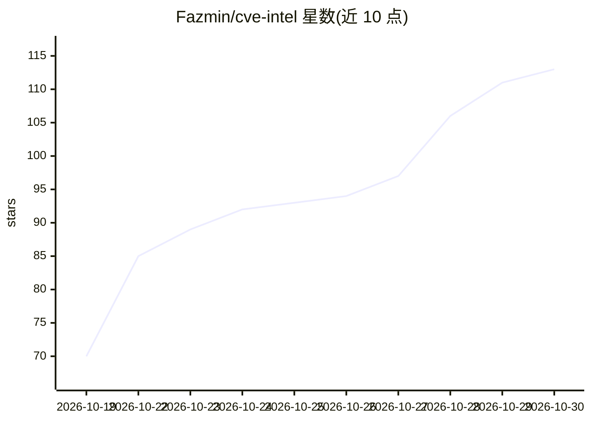

# Fazmin/cve-intel

⭐ 113 · Rust · Apache-2.0 · 推送 2026-10-28 · [GitHub](https://github.com/Fazmin/cve-intel) · 个人维护

**本地优先的 CVE 分诊与漏洞扫描桌面应用（Rust，含 CLI/REST/MCP）**

用 Rust + Tauri 2 编写的本地漏洞分诊与扫描桌面应用：输入 CVE ID、项目文件夹、lockfile/SBOM、本机软件、容器镜像或可疑 IP/哈希/域名，可同时查询最多 39 个公开安全数据源（CISA KEV、FIRST EPSS、NVD、ENISA EUVD、Metasploit、Exploit-DB 等），生成 0-100 风险分、补丁建议与证据链；提供威胁动态周报、产品监控 watchlist、依赖扫描与威胁情报查询。内置本地 AI 助手（可下载本地模型，默认不上云），并可作为 CLI、REST API 与 MCP server 供 AI 编码助手调用。面向安全分析师、IT/运维团队与开发者，无账号与 API key 即可使用，不主动探测或攻击任何目标。

## 筛选速览

| 维度 | 判定 | 备注 |
|---|---|---|
| AI 角色 | `ai-enhanced` | 去掉 AI 部分产品仍成立 |
| 许可风险 | `permissive` | Apache-2.0 |
| 部署形态 | `desktop` | 安装包/桌面程序 |
| 模型依赖 | local-ok | 支持本地模型 |
| 硬件要求 | — | 无带数字的原话,不猜 |
| 安装摩擦 | `low` | 无编译、无系统依赖或容器化 |
| 成熟度 | — | 结构信号不足 |

## 能力要点

- 单次查询聚合最多 39 个公开安全数据源并给出 0-100 风险分与证据链
- 依赖扫描（项目文件夹/lockfile/SBOM/本机软件/容器镜像）按真实风险排序
- 本地 watchlist 监控厂商、产品、包与 CVE 的变更并记录差异
- 内置可下载本地模型的 AI 助手，并以 CLI/REST API/MCP server 形式供开发者和 AI agent 使用

## 适用场景

- 拿到扫描器报告后对一批 CVE 排出补丁优先级
- 检查项目依赖或本机安装软件的已知漏洞
- 通过 MCP 让 Claude Code/Cursor 等编码助手在开发时查询漏洞情报

## 场景标签

`网络安全` · 领域:学习与行业

## 证据(README 行号)

> L4:  A private desktop app for vulnerability triage and scanning, written in native Rust, with a CLI, REST API and MCP s
> L70: the built-in AI assistant runs locally unless you choose a cloud provider.
> L165: 6. *Optional:* open **Local Model** and download a model to use **Ask AI**
> L166:  with answers that never leave your computer.

## 星数曲线

2026-10-19 70 → 2026-10-30 113（+43）

---
*卡片 v1 · prompt 1.4 · 生成 2026-10-24 · 置信度 mid · 依据 README sha `2cbd580bf1a4` · [字段定义](../../DATASET.md)*
