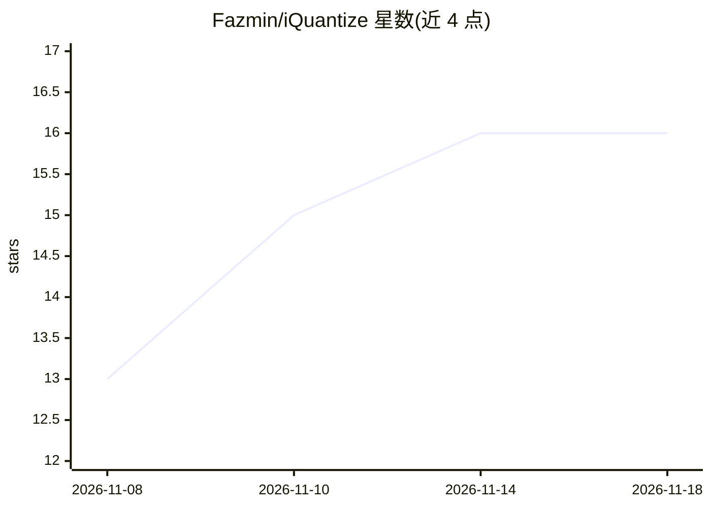

# Fazmin/iQuantize

⭐ 16 · JavaScript · Apache-2.0 · 推送 2026-11-06 · [GitHub](https://github.com/Fazmin/iQuantize) · 个人维护

**桌面工作台：把 LLM 量化为 GGUF/MLX/ONNX 并发布到 Hugging Face**

基于 Tauri v2（Rust + 无框架 JS）的桌面应用，面向需要在本地压缩 LLM 的用户：从 Hugging Face 搜索下载模型，向导式选择量化方案，输出 GGUF/MLX/ONNX 三种格式；提供逐张量实时视图、与原模型的并排对话对比、困惑度/KL 散度评测、速度基准，并自动生成模型卡上传 Hugging Face。应用自动下载 uv、私有 Python 3.12 与各平台 llama.cpp 构建，不改动系统 Python。macOS Apple Silicon 为主要验证平台，MLX 仅限 Apple Silicon。

## 筛选速览

| 维度 | 判定 | 备注 |
|---|---|---|
| AI 角色 | `ai-ecosystem` | LLM/agent 周边工具 |
| 许可风险 | `permissive` | Apache-2.0 |
| 部署形态 | `desktop` | 安装包/桌面程序 |
| 模型依赖 | local-ok | 支持本地模型 |
| 硬件要求 | — | 无带数字的原话,不猜 |
| 安装摩擦 | `medium` | 含编译或系统依赖之一 |
| 成熟度 | — | 结构信号不足 |

## 能力要点

- 支持 GGUF/MLX/ONNX 三种格式的量化向导与逐张量规则
- 量化前后并排对比：流式对话、困惑度、KL 散度、ROUGE-L 与速度基准
- 自动搭建隔离工具链：uv、私有 Python 3.12、按 OS/GPU 匹配的 llama.cpp 构建
- 确定性模型卡与 quantization_report.json 记录工具版本与配方，便于复现

## 适用场景

- 把 Hugging Face 上的模型量化为 GGUF/MLX/ONNX 以减小体积并在本地运行
- 对比多个量化变体的质量、困惑度与速度后择优
- 自动生成模型卡并发布量化后的模型到 Hugging Face

## 场景标签

`模型量化` `模型评测` · 领域:评测与运维

## 证据(README 行号)

> L6: A desktop workspace for quantizing LLMs to **GGUF**, **MLX** and **ONNX**, step by step. You can see exactly what ch
> L14: - **One-click toolchain.** The app downloads `uv`, installs a private Python 3.12, and creates one isolated environ
> L22: |**GGUF**|Every llama.cpp type, including K-quants and I-quants; importance matrix with calibration data; per-tenso

## 星数曲线

2026-11-08 13 → 2026-11-18 16（+3）

---
*卡片 v1 · prompt 1.4 · 生成 2026-11-18 · 置信度 high · 依据 README sha `8f1e37c72740` · [字段定义](../../DATASET.md)*
