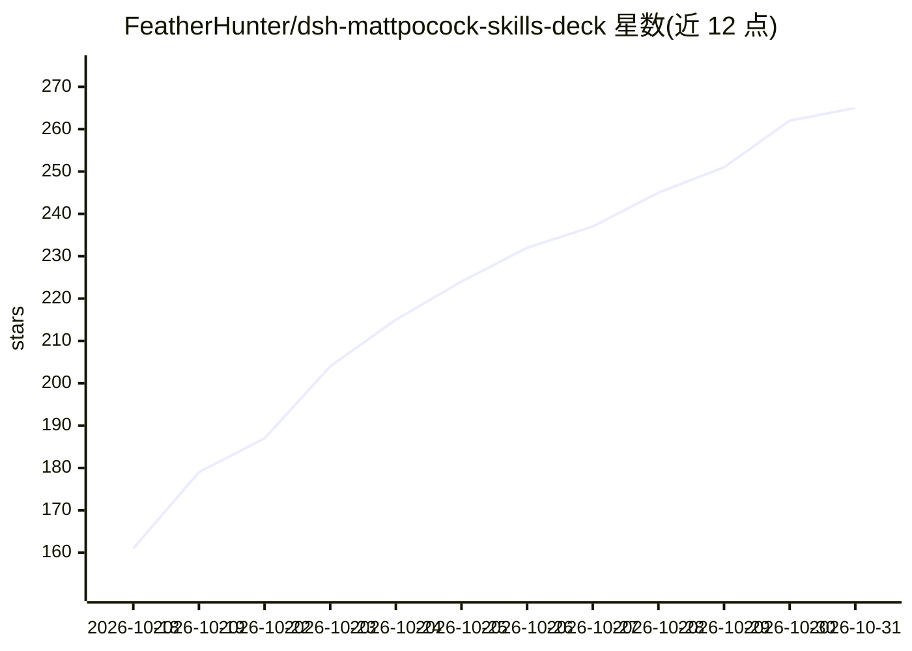

# FeatherHunter/dsh-mattpocock-skills-deck

⭐ 265 · TypeScript · MIT · 推送 2026-10-30 · [GitHub](https://github.com/FeatherHunter/dsh-mattpocock-skills-deck) · [官网](https://featherhunter.github.io/dsh-mattpocock-skills-deck/architecture/MattSkills-architecture.html) · 个人维护 · 中文 README

**DeepSeek Harness 插件：把 mattpocock/skills 任务化为可视任务板**

面向 DSH（DeepSeek Harness）的侧边栏插件，内置 mattpocock/skills v1.3.1 快照的 27 个技能，装好即用。提供任务板列表（按可接/阻塞/已关闭分组）、底部胶囊状态栏、Issue 详情与评论面板、新会话预填指令、技能快捷入口（默认推荐 /ask-matt），并支持 GitHub、本地 Markdown（预览）、GitLab（暂不支持）等多后端切换。任务板绑定的仓库需要 push/triage 权限才能使用标签流转。通过 dsh plugin 命令安装，零配置，装完需重启 DSH 入口生效。

## 筛选速览

| 维度 | 判定 | 备注 |
|---|---|---|
| AI 角色 | `ai-ecosystem` | LLM/agent 周边工具 |
| 许可风险 | `permissive` | MIT |
| 部署形态 | `library` | 以包/库形式分发 |
| 模型依赖 | locked-api |  |
| 硬件要求 | — | 无带数字的原话,不猜 |
| 安装摩擦 | `low` | 无编译、无系统依赖或容器化 |
| 成熟度 | — | 结构信号不足 |

## 能力要点

- 随包内置 27 个技能（快照 v1.3.1），无需手动安装
- 任务板按可接/阻塞/已关闭分组，行按钮直达动作
- GitHub/本地 Markdown/GitLab/Other 多后端切换，切换保留原数据
- 每会话底部胶囊状态栏显示可接数量、BUG 数与环境进度

## 适用场景

- 在 DSH 侧边栏可视化管理仓库里的 AI 任务
- 不记斜杠指令也能通过技能页加载 27 个内置技能
- 在面板里直接查看和回复 Issue 评论，另起干净会话干活

## 场景标签

 · 领域:开发者工具/AI Agent 界面

## 证据(README 行号)

> L16: 前置要求：DSH（DeepSeek Harness）。在 DSH 里，你下指令、AI 干活；MattSkillsDeck 把这些活变成面板上的任务。
> L99: 随包 27 个技能（快照 v1.3.1）装好即用：面板技能页顶部给通用推荐（默认 /ask-matt），列表一行讲清一个技能的中文用途，点加载就把斜杠指令填进输入框。完整名单与教程见 Matt 官方 aihero.dev/skil
> L103: 同一个面板可换跑道：设置页后端选择器列出 GitHub、本地 Markdown、GitLab 与 Other（无后端）逃生舱。切换只换数据源：切换后原数据不可见，原后端数据保留，切回来又可见。新人第一次大多只用一条跑道，知道能换

## 星数曲线

2026-10-18 161 → 2026-10-31 265（+104）

---
*卡片 v1 · prompt 1.4 · 生成 2026-10-22 · 置信度 high · 依据 README sha `01bf05ac0ee2` · [字段定义](../../DATASET.md)*
