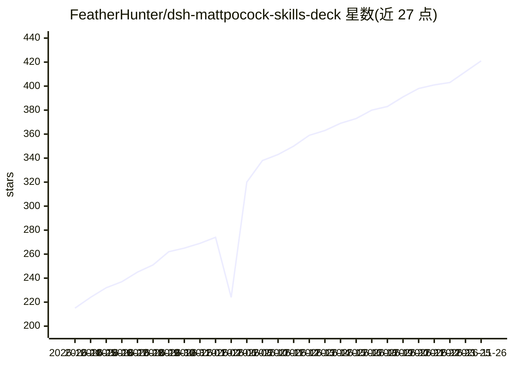

# FeatherHunter/dsh-mattpocock-skills-deck

⭐ 421 · TypeScript · MIT · 推送 2026-11-25 · [GitHub](https://github.com/FeatherHunter/dsh-mattpocock-skills-deck) · [官网](https://featherhunter.github.io/dsh-mattpocock-skills-deck/architecture/MattSkills-architecture.html) · 个人维护 · 中文 README

**将 mattpocock/skills 任务流程可视化为面板的 DSH 插件**

DSH CLI 的插件，安装即内置 mattpocock/skills v1.3.2 的 27 个技能，无需手动安装。将技能的任务拆分以侧边栏任务板、地图卡片、单票详情呈现，支持会话并发处理，并覆盖需求引导、胶囊状态栏、后端切换（GitHub/GitLab/本地 Markdown，Markdown 为预览版）、环境自检、版本管理与标签配色设置。支持 GitHub 与 GitLab 的 issue；GitHub 后端需本机 gh 账号具备 push/triage 权限，只读账号仅可浏览。

## 筛选速览

| 维度 | 判定 | 备注 |
|---|---|---|
| AI 角色 | `ai-enhanced` | 去掉 AI 部分产品仍成立 |
| 许可风险 | `permissive` | MIT |
| 部署形态 | `library` | 以包/库形式分发 |
| 模型依赖 | locked-api |  |
| 硬件要求 | — | 无带数字的原话,不猜 |
| 安装摩擦 | `low` | 无编译、无系统依赖或容器化 |
| 成熟度 | — | 结构信号不足 |

## 能力要点

- 内置 27 个技能（v1.3.2），并提供技能原文查看入口
- 任务板支持多工作区多会话并发执行拆分后的任务
- 多后端：GitHub、GitLab、本地 Markdown（预览版）
- 六步初始化流程与环境逐项自检

## 适用场景

- 在 DSH 侧边栏以任务面板方式管理 AI 拆分的开发任务
- 通过 GitHub/GitLab issue 流转推进开发需求
- 新手学习并使用 mattpocock/skills 技能套件

## 场景标签

`编码 Agent` · 领域:编码与开发

## 证据(README 行号)

> L6: 让 mattpocock/skills 在 DSH 里化作游戏系统的任务面板。
> L21: npm install -g @deepseek-ai/dsh
> L30: DSH侧边栏-总览任务面板全貌。通过插件内置SKILLS的任务拆分，可以做到session并发处理。效率加倍省心。

## 星数曲线

2026-10-24 215 → 2026-11-26 421（+206）

---
*卡片 v1 · prompt 1.4 · 生成 2026-11-26 · 置信度 mid · 依据 README sha `80a931fe4b7f` · [字段定义](../../DATASET.md)*
