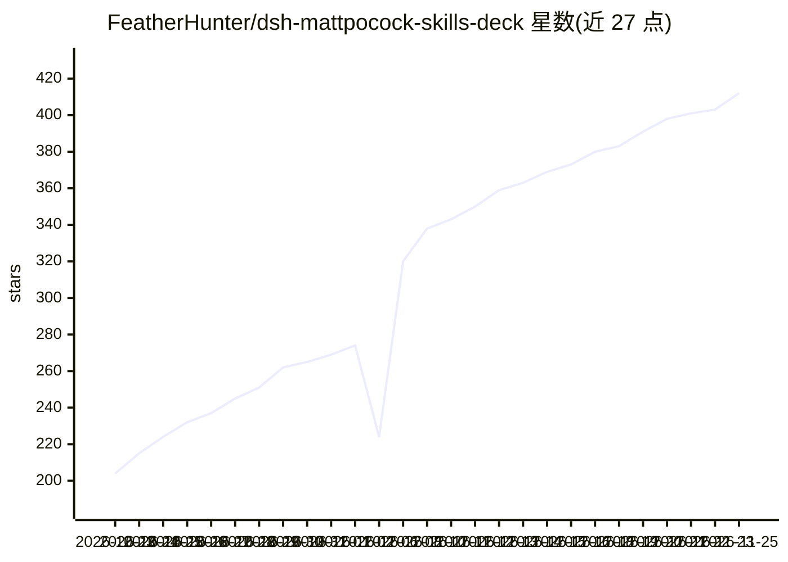

# FeatherHunter/dsh-mattpocock-skills-deck

⭐ 412 · TypeScript · MIT · 推送 2026-11-23 · [GitHub](https://github.com/FeatherHunter/dsh-mattpocock-skills-deck) · [官网](https://featherhunter.github.io/dsh-mattpocock-skills-deck/architecture/MattSkills-architecture.html) · 个人维护 · 中文 README

**DSH 插件：把 mattpocock/skills 27个技能化为 issue 任务板**

面向 DSH CLI 用户的插件，安装即内置 mattpocock/skills v1.3.2 的 27 个技能，无需手动安装。核心功能：将 GitHub/GitLab issue 映射为侧边栏任务板，支持技能拆分任务后的多会话并发处理、一键注入 prompt、单票详情查看、胶囊状态栏、多后端切换（GitHub/本地 Markdown/GitLab）、环境自检、版本管理与标签配色设置。使用 GitHub 后端需本机 gh 账号具备 push/triage 权限；本地 Markdown 后端为预览版，GitLab 后端尚无人力开发。

## 筛选速览

| 维度 | 判定 | 备注 |
|---|---|---|
| AI 角色 | `ai-ecosystem` | LLM/agent 周边工具 |
| 许可风险 | `permissive` | MIT |
| 部署形态 | `library` | 以包/库形式分发 |
| 模型依赖 | — | README 未给出锁定关系 |
| 硬件要求 | — | 无带数字的原话,不猜 |
| 安装摩擦 | `low` | 无编译、无系统依赖或容器化 |
| 成熟度 | — | 结构信号不足 |

## 能力要点

- 内置 mattpocock/skills v1.3.2 共 27 个技能并提供原文查看
- issue 任务板支持技能拆分任务与多会话并发处理
- GitHub / GitLab / 本地 Markdown 三种后端可切换
- 六步引导式初始化流程与环境逐项自检

## 适用场景

- 在 DSH 里把仓库 issue 变成可视化任务面板逐个推进
- 用内置技能拆分任务后多会话并发执行
- 新手想学习 mattpocock/skills 原始技能内容

## 场景标签

`工作流自动化` `提示工程` · 领域:Agent 开发

## 证据(README 行号)

> L6: 让 mattpocock/skills 在 DSH 里化作游戏系统的任务面板。
> L21: npm install -g @deepseek-ai/dsh
> L30: DSH侧边栏-总览任务面板全貌。通过插件内置SKILLS的任务拆分，可以做到session并发处理。效率加倍省心。

## 星数曲线

2026-10-23 204 → 2026-11-25 412（+208）

---
*卡片 v1 · prompt 1.4 · 生成 2026-11-25 · 置信度 high · 依据 README sha `0e2beceff1d0` · [字段定义](../../DATASET.md)*
