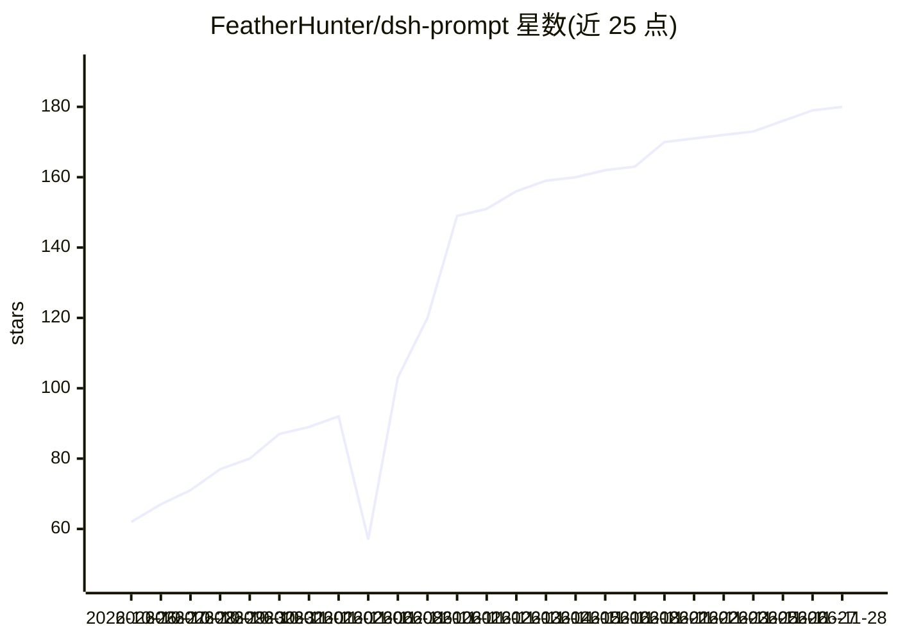

# FeatherHunter/dsh-prompt

⭐ 180 · JavaScript · MIT · 推送 2026-11-08 · [GitHub](https://github.com/FeatherHunter/dsh-prompt) · [官网](https://www.npmjs.com/package/dsh-prompt) · 个人维护 · 中文 README

**DSH 的 Prompt 模板工具箱插件：一键注入常用提示词**

面向 DSH（DeepSeek Harness）CLI 的 Prompt 提示词工具箱插件：将常用 Prompt 保存为模板，点击按钮或通过 /prompt 斜杠命令注入对话框；提供 24 条预制模板，自定义模板支持名称、标签、文字颜色、正文的配置，正文按原样保留并可用 {{cursor}} 控制光标落点。悬浮面板支持范围与标签筛选、预制模板屏蔽开关、悬浮/点击两种触发方式。安装依赖 DSH CLI，通过 npm 全局安装后重启生效。

## 筛选速览

| 维度 | 判定 | 备注 |
|---|---|---|
| AI 角色 | `ai-ecosystem` | LLM/agent 周边工具 |
| 许可风险 | `permissive` | MIT |
| 部署形态 | `library` | 以包/库形式分发 |
| 模型依赖 | — | README 未给出锁定关系 |
| 硬件要求 | — | 无带数字的原话,不猜 |
| 安装摩擦 | `low` | 无编译、无系统依赖或容器化 |
| 成熟度 | — | 结构信号不足 |

## 能力要点

- Prompt 按钮悬浮面板：标签筛选、一键屏蔽/展示官方预制模板
- /prompt 或 /p 触发斜杠候选列表，继续输入可缩小范围
- 自定义模板支持名称、标签、60 色文字颜色、描边与 {{cursor}} 光标标记
- 正文按原样保留换行与空行，只忽略首尾空格与制表符

## 适用场景

- 把重复使用的 Prompt 存成模板，点击注入对话框省去复制粘贴
- 给团队常用提示词打标签分类，在面板里按标签筛选
- 需要控制插入后光标位置的多段式提示词模板

## 场景标签

`提示工程` · 领域:Agent 开发

## 证据(README 行号)

> L16: 前置要求：DSH（DeepSeek Harness）。
> L45: 只敲一个 `/` 不再列出模板，命令菜单保持干净；敲 `/prompt` 或者 `/p` 才看到全部模板。

## 星数曲线

2026-10-26 62 → 2026-11-28 180（+118）

---
*卡片 v1 · prompt 1.4 · 生成 2026-11-26 · 置信度 high · 依据 README sha `a78c3204c87c` · [字段定义](../../DATASET.md)*
