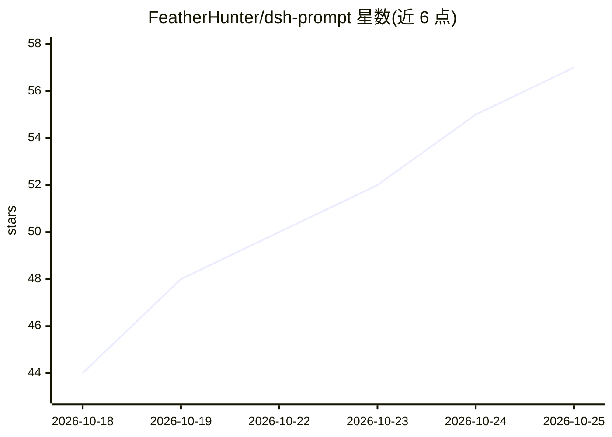

# FeatherHunter/dsh-prompt

⭐ 57 · JavaScript · MIT · 推送 2026-10-24 · [GitHub](https://github.com/FeatherHunter/dsh-prompt) · [官网](https://www.npmjs.com/package/dsh-prompt) · 个人维护 · 中文 README

**DSH 客户端的 Prompt 模板插件：保存常用提示词一键注入对话框**

面向 DSH（DeepSeek Harness）的提示词工具箱插件：将常用 Prompt 保存为模板，通过输入框左侧 Prompt 按钮或 /prompt、/p 触发源一键注入对话框。提供 24 条官方预制模板（可屏蔽）、名称/标签/文字颜色（60 色、描边）自定义，支持范围与标签筛选。前置要求为已安装 DSH CLI，通过 npm 安装后重启 DSH 生效。

## 筛选速览

| 维度 | 判定 | 备注 |
|---|---|---|
| AI 角色 | `ai-ecosystem` | LLM/agent 周边工具 |
| 许可风险 | `permissive` | MIT |
| 部署形态 | `library` | 以包/库形式分发 |
| 模型依赖 | — | README 未给出锁定关系 |
| 硬件要求 | — | 无带数字的原话,不猜 |
| 安装摩擦 | `low` | 无编译、无系统依赖或容器化 |
| 成熟度 | — | 结构信号不足 |

## 能力要点

- Prompt 按钮 + /prompt 触发源双入口，一键注入对话框
- 24 条预制模板，可屏蔽/解除屏蔽
- 自定义模板支持名称、标签、文字颜色（60 色）与描边
- /prompt 关键词可缩小候选范围，候选含模板名+标签+正文开头

## 适用场景

- 把重复使用的 Prompt 保存为模板，免去每次复制粘贴
- 按标签筛选快速找到需要的提示词并注入
- 屏蔽预制模板只保留自己的模板集

## 场景标签

`提示工程` · 领域:Agent 开发

## 证据(README 行号)

> L16: 前置要求：DSH（DeepSeek Harness）。
> L33: 鼠标移到输入框左侧的「Prompt」按钮，列表自动展开——官方预置模板和我们自定义的模板都能看到。

## 星数曲线

2026-10-18 44 → 2026-10-25 57（+13）

---
*卡片 v1 · prompt 1.4 · 生成 2026-10-24 · 置信度 low · 依据 README sha `021d3481f5b7` · [字段定义](../../DATASET.md)*
