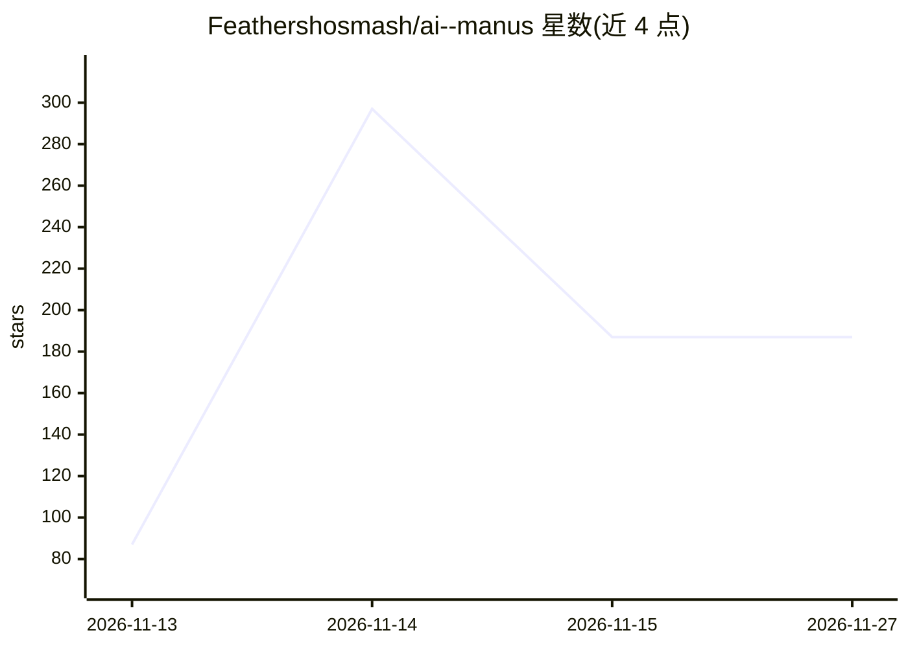

# Feathershosmash/ai--manus

⭐ 187 · Apache-2.0 · 推送 2026-11-15 · [GitHub](https://github.com/Feathershosmash/ai--manus) · 个人维护

**面向个人用户的自主 AI Agent：代为执行代码与浏览器操作**

Manus 定位为自主 AI 代理，声称可在用户指令下编写并执行脚本、控制浏览器完成表单填写、信息收集等多步骤任务，主要面向学习、家庭与轻办公场景的学生、远程工作者等非开发者用户。描述为沙箱环境运行工具的通用 Agent 系统，但 README 为营销式说明，未给出技术架构、模型接入方式、安装命令或源码构建说明，仅提供硬件兼容性表格与使用步骤建议。

## 筛选速览

| 维度 | 判定 | 备注 |
|---|---|---|
| AI 角色 | `ai-native` | 本体是模型或模型工具 |
| 许可风险 | `permissive` | Apache-2.0 |
| 部署形态 | `None` |  |
| 模型依赖 | — | README 未给出锁定关系 |
| 硬件要求 | — | 无带数字的原话,不猜 |
| 安装摩擦 | `low` | 无编译、无系统依赖或容器化 |
| 成熟度 | — | 结构信号不足 |

## 能力要点

- 自主执行代码与脚本
- 浏览器控制：导航网页、填写表单、收集信息
- 多步骤任务可在脚本与浏览器操作间衔接
- 面向小规模个人场景而非企业平台

## 适用场景

- 让学生整理研究笔记、跑快速计算
- 远程工作者从多页面收集数据做摘要
- 把重复性小任务委派给后台代理执行

## 场景标签

`编码 Agent` `浏览器自动化` · 领域:效率与自动化

## 证据(README 行号)

> L10: - **Autonomous Code Execution:** Manus AI agent runs code on its own to complete tasks, so you can focus on decisio
> L18: Manus is an autonomous AI agent designed to run code and control a browser on your behalf. Instead of acting like a

## 星数曲线

2026-11-13 87 → 2026-11-27 187（+100）

---
*卡片 v1 · prompt 1.4 · 生成 2026-11-17 · 置信度 low · 依据 README sha `fbfd5e977bf4` · [字段定义](../../DATASET.md)*
