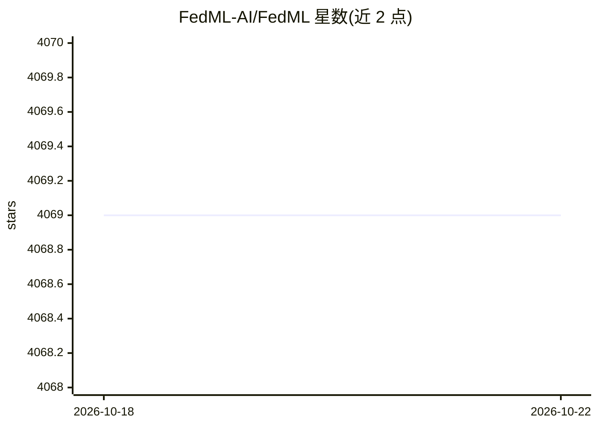

# FedML-AI/FedML

⭐ 4,069 · Python · Apache-2.0 · 推送 2025-10-28 · [GitHub](https://github.com/FedML-AI/FedML) · [官网](https://TensorOpera.ai) · 组织维护

**分布式训练、模型服务与联邦学习的统一 ML 库**

面向开发者的机器学习库，覆盖大规模分布式训练、模型部署与联邦学习，并支持在去中心化 GPU、多云、边缘服务器与智能手机上运行任务。配套 FEDML Launch 跨云调度器，可跨 GPU 云与本地集群调度 AI 作业。其上构建了商业云服务 TensorOpera AI，提供 MLOps、调度器与算力库三层基础设施，包括 Studio 微调部署、Job Store 预置作业、Train/Deploy/Federate 等平台；由公司维护，开源库与商业平台高度关联。

## 筛选速览

| 维度 | 判定 | 备注 |
|---|---|---|
| AI 角色 | `ai-ecosystem` | LLM/agent 周边工具 |
| 许可风险 | `permissive` | Apache-2.0 |
| 部署形态 | `None` |  |
| 模型依赖 | — | README 未给出锁定关系 |
| 硬件要求 | — | 无带数字的原话,不猜 |
| 安装摩擦 | `low` | 无编译、无系统依赖或容器化 |
| 成熟度 | — | 结构信号不足 |

## 能力要点

- 统一库支持训练、部署与联邦学习三类任务
- FEDML Launch 跨云调度，支持 GPU 云、本地与混合集群
- 支持智能手机端训练与边缘服务器场景
- 开源库与 TensorOpera AI 云平台集成

## 适用场景

- 跨多云/本地集群做大规模分布式训练
- 部署与扩展模型服务
- 在边缘设备与手机上开展联邦学习

## 场景标签

`模型训练` `推理引擎` `MLOps` · 领域:训练与推理

## 证据(README 行号)

> L1: # FEDML Open Source: A Unified and Scalable Machine Learning Library for Running Training and Deployment Anywhere at
> L18: A typical workflow is showing in figure above. When developer wants to run a pre-built job in Studio or Job Store, 

## 星数曲线

2026-10-18 4,069 → 2026-10-22 4,069（+0）

---
*卡片 v1 · prompt 1.4 · 生成 2026-10-20 · 置信度 high · 依据 README sha `7d53dd0807b2` · [字段定义](../../DATASET.md)*
