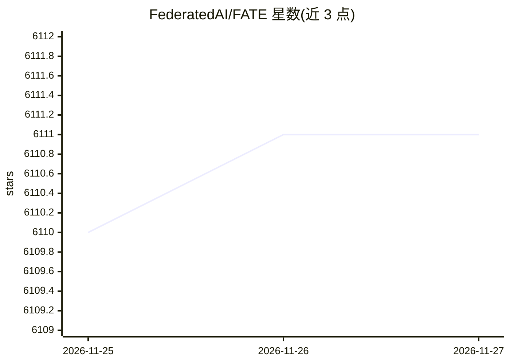

# FederatedAI/FATE

⭐ 6,111 · Python · Apache-2.0 · 推送 2026-11-26 · [GitHub](https://github.com/FederatedAI/FATE) · 组织维护

**面向企业与机构的工业级联邦学习开源框架**

FATE（Federated AI Technology Enabler）为 Linux Foundation 托管的开源项目，基于同态加密与多方安全计算（MPC）实现安全计算协议，支持多种联邦学习场景，提供逻辑回归、树模型、深度学习与迁移学习等联邦学习算法。支持单机（standalone）与集群两种部署方式，单机可通过 PyPI、预构建 docker 镜像或安装包部署，集群通过 CLI 或 docker-compose 部署。配套生态包括 KubeFATE、FATE-Flow 调度平台、FATE-Board 可视化工具、FATE-Serving 模型服务系统及 FATE-LLM 大模型联邦学习框架。采用 Apache License 2.0 许可。

## 筛选速览

| 维度 | 判定 | 备注 |
|---|---|---|
| AI 角色 | `ai-native` | 本体是模型或模型工具 |
| 许可风险 | `permissive` | Apache-2.0 |
| 部署形态 | `library` | 以包/库形式分发 |
| 模型依赖 | — | README 未给出锁定关系 |
| 硬件要求 | — | 无带数字的原话,不猜 |
| 安装摩擦 | `low` | 无编译、无系统依赖或容器化 |
| 成熟度 | — | 结构信号不足 |

## 能力要点

- 基于同态加密与多方安全计算（MPC）的安全计算协议
- 提供逻辑回归、树模型、深度学习、迁移学习等联邦学习算法
- 支持单机与集群部署（PyPI/docker 镜像/CLI/docker-compose）
- 配套 FATE-Flow、FATE-Board、FATE-Serving、KubeFATE 等子项目

## 适用场景

- 企业间在数据不出本地的前提下联合训练机器学习模型
- 在单机上测试与体验联邦学习流程
- 通过 KubeFATE 在 Kubernetes 上运维联邦学习平台
- 对大语言模型进行联邦学习（FATE-LLM）

## 场景标签

`模型训练` `微调` · 领域:训练与推理

## 证据(README 行号)

> L7: FATE (Federated AI Technology Enabler) is the world's first industrial grade federated learning open source framewor
> L9: Supporting various federated learning scenarios, FATE now provides a host of federated learning algorithms, includin
> L22: - Deploying FATE on a single node via PyPI, pre-built docker images or installers. It is for simple testing purpose

## 星数曲线

2026-11-25 6,110 → 2026-11-27 6,111（+1）

---
*卡片 v1 · prompt 1.4 · 生成 2026-11-27 · 置信度 high · 依据 README sha `e7d1f2b7f2fa` · [字段定义](../../DATASET.md)*
