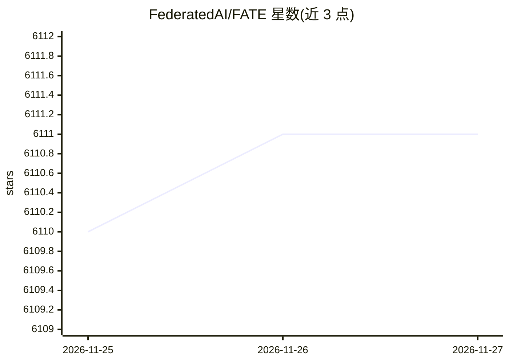

# FederatedAI/FATE

⭐ 6,111 · Python · Apache-2.0 · 推送 2026-11-26 · [GitHub](https://github.com/FederatedAI/FATE) · 组织维护

**面向企业机构的工业级联邦学习框架，支持隐私保护协同建模**

FATE（Federated AI Technology Enabler）是基于同态加密与多方计算（MPC）实现安全计算协议的联邦学习框架，由 Linux Foundation 托管。提供逻辑回归、树模型、深度学习、迁移学习等多种联邦学习算法，支持单机与集群部署（PyPI、预构建 Docker 镜像、安装包、docker-compose、CLI）。配套 FATE-Flow 调度、FATE-Board 可视化、FATE-Serving 模型服务、KubeFATE 云原生运维、FATE-LLM 大模型联邦学习等子项目。

## 筛选速览

| 维度 | 判定 | 备注 |
|---|---|---|
| AI 角色 | `ai-ecosystem` | LLM/agent 周边工具 |
| 许可风险 | `permissive` | Apache-2.0 |
| 部署形态 | `library` | 以包/库形式分发 |
| 模型依赖 | — | README 未给出锁定关系 |
| 硬件要求 | — | 无带数字的原话,不猜 |
| 安装摩擦 | `low` | 无编译、无系统依赖或容器化 |
| 成熟度 | — | 结构信号不足 |

## 能力要点

- 基于同态加密与 MPC 的安全计算协议
- 提供多种联邦学习算法（逻辑回归/树模型/深度学习/迁移学习）
- 支持单机与集群部署（PyPI/Docker/docker-compose/CLI）
- 配套调度、可视化、服务化、云原生运维等子项目生态

## 适用场景

- 多方机构在数据不出域前提下联合训练模型
- 企业部署生产级联邦学习建模与服务管线
- 基于 KubeFATE 在 Kubernetes 上运维联邦学习集群

## 场景标签

`模型训练` `MLOps` · 领域:训练与推理

## 证据(README 行号)

> L7: FATE (Federated AI Technology Enabler) is the world's first industrial grade federated learning open source framewor
> L22: - Deploying FATE on a single node via PyPI, pre-built docker images or installers. It is for simple testing purpose

## 星数曲线

2026-11-25 6,110 → 2026-11-27 6,111（+1）

---
*卡片 v1 · prompt 1.4 · 生成 2026-11-24 · 置信度 high · 依据 README sha `a1ee10f00c42` · [字段定义](../../DATASET.md)*
