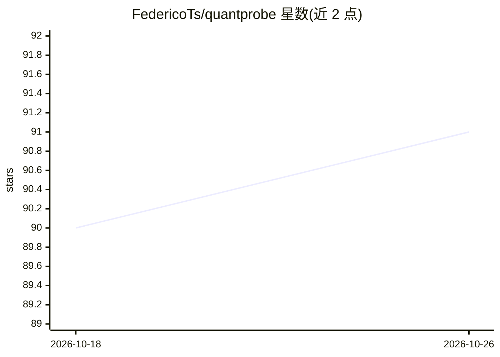

# FedericoTs/quantprobe

⭐ 91 · Python · MIT · 推送 2026-10-07 · [GitHub](https://github.com/FedericoTs/quantprobe) · [官网](https://federicots.github.io/quantprobe/) · 个人维护

**本地大模型量化与部署规划工具：下载前预测 tok/s 与显存内存匹配**

面向在本地硬件上运行 GGUF 模型的用户：quantprobe 在下载前探测机器（VRAM/RAM/磁盘带宽）、按多种放置方案预测 tok/s 并指出瓶颈资源，自动选择量化方案、下载并生成 llama.cpp 命令（quantprobe auto 一条命令完成）。支持逐层测量模型脆弱层后构建硬件专属的分层量化文件，用困惑度与 KL 散度验证质量，并可审计已运行的 Ollama 安装的放置决策。以 pip 包提供，运行于原版 llama.cpp，无需编译。

## 筛选速览

| 维度 | 判定 | 备注 |
|---|---|---|
| AI 角色 | `ai-ecosystem` | LLM/agent 周边工具 |
| 许可风险 | `permissive` | MIT |
| 部署形态 | `library` | 以包/库形式分发 |
| 模型依赖 | local-ok | 支持本地模型 |
| 硬件要求 | — | 无带数字的原话,不猜 |
| 安装摩擦 | `low` | 无编译、无系统依赖或容器化 |
| 成熟度 | — | 结构信号不足 |

## 能力要点

- 下载前按 VRAM/RAM/磁盘多层放置预测 tok/s 并指出绑定资源
- quantprobe calibrate 用本机基准运行校准预测（留一法中位误差 19%→5.8%）
- 逐层测量脆弱层并构建分层感知的量化文件
- audit-ollama 读取 Ollama 实际放置并对比规划器结果

## 适用场景

- 下载大模型前判断我的机器能否跑得动、能跑多快
- 让工具自动选量化方案、下载并生成 llama.cpp 启动命令
- 核验社区流传的速度宣称（如 DGX Spark 跑 70B 的说法）是否成立

## 场景标签

`模型量化` `模型评测` · 领域:评测与运维

## 证据(README 行号)

> L13: Most tools help you pick a quantization someone else built. This one **measures your model, then builds a file that
> L83: - Runs on stock llama.cpp. No custom runtime, nothing to build.

## 星数曲线

2026-10-18 90 → 2026-10-26 91（+1）

---
*卡片 v1 · prompt 1.4 · 生成 2026-10-23 · 置信度 high · 依据 README sha `bd8d81d32f74` · [字段定义](../../DATASET.md)*
