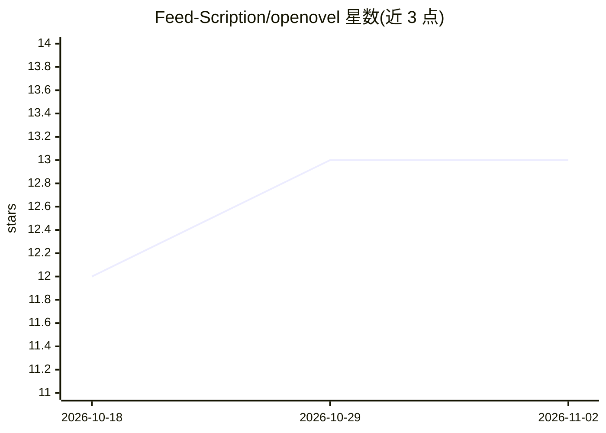

# Feed-Scription/openovel

⭐ 13 · JavaScript · Apache-2.0 · 推送 2026-06-17 · [GitHub](https://github.com/Feed-Scription/openovel) · 个人维护

**本地优先的 AI 互动小说桌面应用：前台叙述流式生成，后台 agent 维护故事文件**

Electron 桌面应用：读者输入主角行动，前台叙述模型流式产出下一段情节；后台异步 agent 团队（Showrunner 协调者加 World Keeper、Director、Card Manager、Memory）读取回合结果并更新普通 Markdown/JSON 文件，构成后续回合的上下文。故事状态全部以普通文件存储，默认运行时不含向量库或 RAG 数据库。支持内置 provider 与自定义 OpenAI 兼容/Anthropic 格式端点，自带 API key。自述处于 beta/demo 阶段，macOS 测试最多，Windows/Linux 包测试较少；macOS 构建临时签名未经公证。

## 筛选速览

| 维度 | 判定 | 备注 |
|---|---|---|
| AI 角色 | `ai-native` | 本体是模型或模型工具 |
| 许可风险 | `permissive` | Apache-2.0 |
| 部署形态 | `library` | 以包/库形式分发 |
| 模型依赖 | — | README 未给出锁定关系 |
| 硬件要求 | — | 无带数字的原话,不猜 |
| 安装摩擦 | `low` | 无编译、无系统依赖或容器化 |
| 成熟度 | `idea` | |

## 能力要点

- 双循环运行时：前台低延迟叙述 + 后台常驻多 agent 文件维护
- 故事状态（canon/记忆/上下文卡/状态）全部为普通文件，无向量库/RAG 数据库
- 桌面故事库管理、EPUB/TXT 导出、建议选项、阅读节奏控制
- 可选图像生成、TTS 朗读、漫画模式等实验功能

## 适用场景

- 玩长篇 AI 互动小说并保留可检查的故事文件
- 自托管、自带模型的本地 AI 小说体验
- 导出互动故事为 EPUB 或 TXT

## 场景标签

`AI 写作` · 领域:内容生成

## 证据(README 行号)

> L12: openovel is an open-source desktop app for playing AI interactive fiction. You type what the protagonist does; a fo
> L207: openovel is a local-first AI interactive fiction desktop app. It streams narration for the reader while background

## 星数曲线

2026-10-18 12 → 2026-11-02 13（+1）

---
*卡片 v1 · prompt 1.4 · 生成 2026-10-31 · 置信度 high · 依据 README sha `d6724e750fd8` · [字段定义](../../DATASET.md)*
