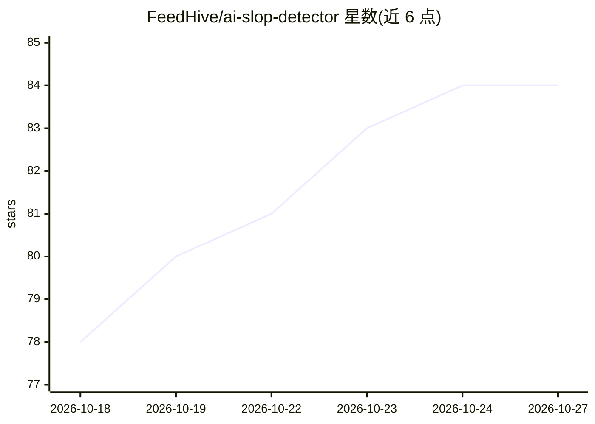

# FeedHive/ai-slop-detector

⭐ 84 · JavaScript · MIT · 推送 2026-10-12 · [GitHub](https://github.com/FeedHive/ai-slop-detector) · [官网](https://www.feedhive.com/tools/ai-slop-detector) · 组织维护

**120 种 AI 味写作模式清单，含 Claude Code/Codex agent 技能**

FeedHive 维护的 AI 写作模式清单：收录 120 个让文本读起来像 AI 生成的模式，按词汇、套话、句式、结构节奏等 9 类组织，每个模式附简短解释、坏例子与改写示例。使用方式包括：作为 agent 技能安装到 Claude Code/Codex、粘贴到聊天应用让模型规避、或通过 patterns.json 结构化数据自建工具（node scripts/build.mjs 可再生成 README 与技能）。清单本身不判断文本由人或 AI 写作，仅识别模式密度。仓库以内容清单为主体，附带一个 SKILL 安装目录。

## 筛选速览

| 维度 | 判定 | 备注 |
|---|---|---|
| AI 角色 | `ai-knowledge` | 知识聚合/清单类 |
| 许可风险 | `permissive` | MIT |
| 部署形态 | `None` |  |
| 模型依赖 | — | README 未给出锁定关系 |
| 硬件要求 | — | 无带数字的原话,不猜 |
| 安装摩擦 | `low` | 无编译、无系统依赖或容器化 |
| 成熟度 | — | 结构信号不足 |

## 能力要点

- 120 个模式按 9 类组织，每个含坏例子与改写示例
- 提供 Claude Code/Codex 的 agent 技能安装方式
- patterns.json 结构化数据 + node scripts/build.mjs 再生成流程

## 适用场景

- 写作前把清单交给 AI 让其规避这些模式
- 用 agent 技能在 Claude Code/Codex 中检查草稿
- 基于 patterns.json 在自有工具中做模式检测

## 场景标签

`AI 写作` `精选清单` · 领域:内容生成

## 证据(README 行号)

> L3: 120 patterns that make writing read like AI slop, in 9 categories. Each pattern has a short explanation, a bad examp
> L11: **Claude Code, Codex and other agents.** Give the agent this repository and ask it to install the skill:
> L26: **Your own tools.** `patterns.json` has the full list as structured data. Edit it and run `node scripts/build.mjs` 

## 星数曲线

2026-10-18 78 → 2026-10-27 84（+6）

---
*卡片 v1 · prompt 1.4 · 生成 2026-10-24 · 置信度 high · 依据 README sha `21aaca82457a` · [字段定义](../../DATASET.md)*
