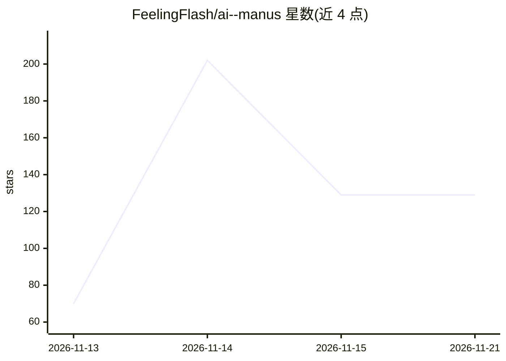

# FeelingFlash/ai--manus

⭐ 129 · Apache-2.0 · 推送 2026-11-15 · [GitHub](https://github.com/FeelingFlash/ai--manus) · 个人维护

**面向个人用户的自主 AI 代理：自动执行代码与浏览器操作**

README 以宣传性文字描述的自主 AI 代理产品：宣称可代用户编写并执行脚本、控制浏览器完成网页导航、表单填写与信息收集，并作为后台个人助手处理学习、家庭与轻量办公中的重复任务。给出兼容性表（双核 CPU、4GB 内存起步）。仓库描述提及在沙盒环境中运行多种工具，主题标签含 openai/anthropic/gemini。但 README 未提供任何安装命令、代码入口或技术实现细节，仅有下载提示与宣传语。

## 筛选速览

| 维度 | 判定 | 备注 |
|---|---|---|
| AI 角色 | `ai-native` | 本体是模型或模型工具 |
| 许可风险 | `permissive` | Apache-2.0 |
| 部署形态 | `None` |  |
| 模型依赖 | — | README 未给出锁定关系 |
| 硬件要求 | — | 无带数字的原话,不猜 |
| 安装摩擦 | `low` | 无编译、无系统依赖或容器化 |
| 成熟度 | — | 结构信号不足 |

## 能力要点

- 宣称支持自主代码执行与浏览器控制的多步任务
- 面向家庭、学习与轻量办公场景的后台个人助手定位
- 给出自身运行的兼容性要求表（双核 CPU / 4GB RAM 起步）

## 适用场景

- 让代理代为执行网页查资料、填表单等重复操作
- 在学习或轻办公中委托脚本运行与信息整理
- 小项目中把脚本与浏览器动作串联完成

## 场景标签

`AI 助手` `浏览器自动化` `编码 Agent` · 领域:效率与自动化

## 证据(README 行号)

> L18: Manus is an autonomous AI agent designed to run code and control a browser on your behalf. Instead of acting like a
> L22: Manus is not a heavy studio suite or a complex enterprise platform. It is a focused helper built for home, study, a

## 星数曲线

2026-11-13 70 → 2026-11-21 129（+59）

---
*卡片 v1 · prompt 1.4 · 生成 2026-11-17 · 置信度 low · 依据 README sha `a3d88e202bf0` · [字段定义](../../DATASET.md)*
