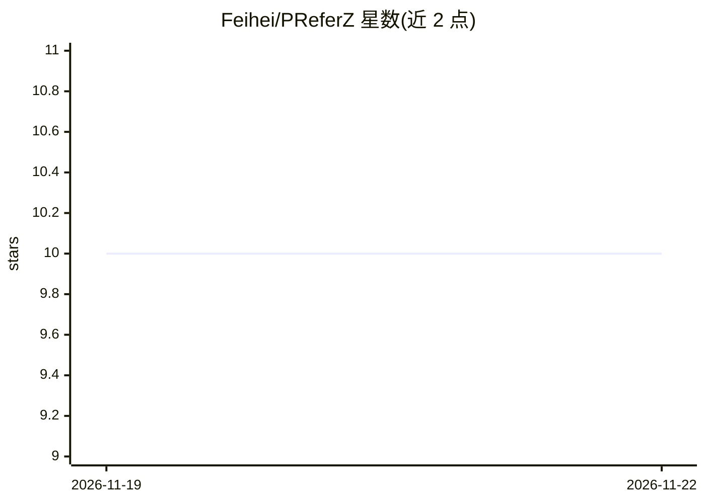

# Feihei/PReferZ

⭐ 10 · Rust · MIT · 推送 2026-11-19 · [GitHub](https://github.com/Feihei/PReferZ) · 个人维护 · 中文 README

**给设计/构思者的轻量参考图画板，AI agent 可经 MCP 操作**

用 Rust 编写的跨平台参考图聚合桌面应用：无限画布、平移缩放、图片导入裁剪、Excalidraw 风格手绘图形、徒手笔迹、文本便签、mermaid 流程图导入、双列数据图表、画框演示、撤销/重做、.prz（SQLite+sqlar）工程存档与自动保存。同一二进制提供无头 CLI（JSONL 协议）与 stdio MCP 服务器，15 个工具可让 agent 实时操作已打开的画布；设计受 BeeRef 与 Excalidraw 启发，格式不与 BeeRef 兼容。MIT 许可，内置中文字体与手写字体。

## 筛选速览

| 维度 | 判定 | 备注 |
|---|---|---|
| AI 角色 | `ai-enhanced` | 去掉 AI 部分产品仍成立 |
| 许可风险 | `permissive` | MIT |
| 部署形态 | `None` |  |
| 模型依赖 | — | README 未给出锁定关系 |
| 硬件要求 | — | 无带数字的原话,不猜 |
| 安装摩擦 | `medium` | 含编译或系统依赖之一 |
| 成熟度 | — | 结构信号不足 |

## 能力要点

- 单二进制多模式：GUI / --mcp / --headless / --exec
- 15 个 MCP 工具与 JSONL 命令一一对应，GUI 打开时实时代理操作画布
- mermaid 流程图导入、两列表格数据生成柱状/折线图
- 无依赖预编译二进制发布，中英双语界面

## 适用场景

- 整理设计参考图并随手标注手绘图形与便签
- 让 AI agent 通过 MCP 在画布上添加图形、流程图和图表
- 无 GUI 的脚本/agent 场景下用 JSONL 协议驱动画布

## 场景标签

`知识库管理` · 领域:知识与检索

## 证据(README 行号)

> L6: A minimalist reference image aggregator desktop app written in Rust. Infinite canvas, pan/zoom, image import, Excali
> L49: - Headless CLI & MCP server: `preferz --mcp` runs a stdio MCP server that proxies to a running GUI window (tools op
> L94: Picture Reference Z - 一个用 Rust 编写的极简参考图聚合桌面应用。无限画布，平移/缩放，图片导入，Excalidraw 风格手绘图形，徒手笔迹，文本便签，流程图，图表，画框演示，撤销/重做，`.prz` 

## 星数曲线

2026-11-19 10 → 2026-11-22 10（+0）

---
*卡片 v1 · prompt 1.4 · 生成 2026-11-20 · 置信度 high · 依据 README sha `e67206cd5d61` · [字段定义](../../DATASET.md)*
