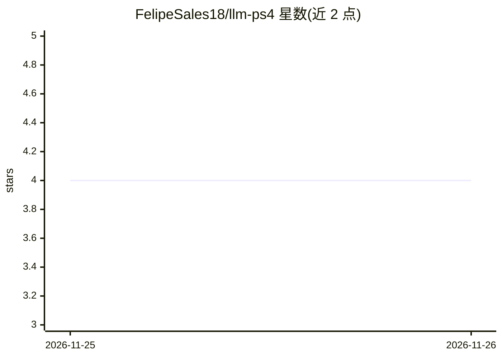

# FelipeSales18/llm-ps4

⭐ 4 · Jupyter Notebook · MIT · 推送 2026-11-23 · [GitHub](https://github.com/FelipeSales18/llm-ps4) · 个人维护

**在 PS4 Linux 上本地运行量化 LLM 的实验项目**

记录在 2013 年 PlayStation 4（Linux）上使用 llama.cpp 运行量化 LLM 的实验：用 GRPO（LoRA）在 GSM8K 上微调 Qwen3-1.7B 使其输出固定格式的数学答案，对比 CPU 与 Vulkan GPU 推理的速度和准确率，并量化 Q4_K_M/Q5_K_M 量化的精度损失。后期扩展为 PS4 上的葡语本地聊天助手，含 360 项自建评测集与配置对比。GPU 驱动（RADV/Vulkan）以用户态方式从 Mesa 包提取，未做系统级安装。

## 筛选速览

| 维度 | 判定 | 备注 |
|---|---|---|
| AI 角色 | `ai-native` | 本体是模型或模型工具 |
| 许可风险 | `permissive` | MIT |
| 部署形态 | `None` |  |
| 模型依赖 | local-ok | 支持本地模型 |
| 硬件要求 | — | 无带数字的原话,不猜 |
| 安装摩擦 | `low` | 无编译、无系统依赖或容器化 |
| 成熟度 | — | 结构信号不足 |

## 能力要点

- GRPO+LoRA 微调 Qwen3-1.7B，GSM8K 严格格式率从 2.9% 提升至 75.8%
- PS4 上 Vulkan GPU 推理较 8 线程 CPU 快 1.56×（11.2s vs 17.5s/题）
- 用户态部署 RADV Vulkan 驱动与 llama.cpp Vulkan 构建，无需 root
- 360 项葡语助手评测集与规则式打分脚本

## 适用场景

- 在游戏主机等非传统硬件上本地推理量化 LLM
- 研究量化级别对准确率与格式遵循的影响
- 复现 CPU 与 GPU 后端的对比评测方法

## 场景标签

`模型评测` `微调` `推理引擎` `模型量化` · 领域:评测与运维

## 证据(README 行号)

> L3: I fine-tuned Qwen3-1.7B with GRPO (LoRA) on GSM8K to answer in a fixed, machine-readable format, and ran it on a 201
> L89: ## Local assistant on the PS4 (added 2026-11-15)
> L148: 3. **llama.cpp:** built with `-DGGML_VULKAN=ON` against Vulkan and SPIR-V headers that were also extracted (with h

## 星数曲线

2026-11-25 4 → 2026-11-26 4（+0）

---
*卡片 v1 · prompt 1.4 · 生成 2026-11-24 · 置信度 high · 依据 README sha `714656e4c8c1` · [字段定义](../../DATASET.md)*
