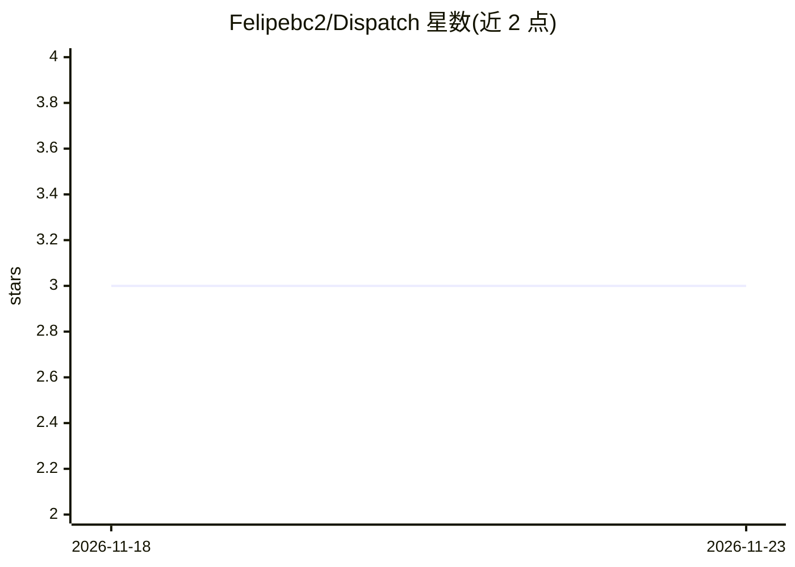

# Felipebc2/Dispatch

⭐ 3 · Python · MIT · 推送 2026-11-16 · [GitHub](https://github.com/Felipebc2/Dispatch) · [官网](https://github.com/Felipebc2/Dispatch) · 个人维护

**CTF 选手的分诊优先解题插件，先分类再派发专家 agent**

运行于 Claude Code 与 Codex 的 CTF 解题插件：`brainstormer` agent 先读取题目并推断类别与攻击向量，在内置 Arsenal（SQLite FTS5 索引，约 121 条模式→方法条目、20 个工具集）中检索已验证方法，随后强制停在人工检查点，用户接受后才派发给 12 个类别 solver（crypto/pwn/web/rev/forensics 等）。solver 对找到的 flag 按可配置格式校验；Ghidra/pwndbg MCP 服务器为可选，缺失时退化为 Bash 工具。用户可通过 Markdown 条目扩展 Arsenal。

## 筛选速览

| 维度 | 判定 | 备注 |
|---|---|---|
| AI 角色 | `ai-native` | 本体是模型或模型工具 |
| 许可风险 | `permissive` | MIT |
| 部署形态 | `None` |  |
| 模型依赖 | — | README 未给出锁定关系 |
| 硬件要求 | — | 无带数字的原话,不猜 |
| 安装摩擦 | `low` | 无编译、无系统依赖或容器化 |
| 成熟度 | — | 结构信号不足 |

## 能力要点

- 分诊→Arsenal 检索→人工检查点→派发 solver 的固定流程
- 强制人工检查点：无用户批准任何 solver 不运行
- 约 121 条问题模式→方法条目的 Arsenal 与 194 个外部工具手册
- 支持 Claude Code 插件市场安装与 Codex skill 运行

## 适用场景

- CTF 比赛中快速判断题目类别并选择解题方法
- 团队沉淀可复用的解题技术条目进 Arsenal
- 需要人工逐步审批的授权靶场演练

## 场景标签

`编码 Agent` `网络安全` · 领域:编码与开发

## 证据(README 行号)

> L18: A CTF challenge lands and you have twelve ways to be wrong about it. **CTF Dispatch** is the
> L44: 1. **Triage.** The `brainstormer` agent reads the raw challenge (text + any attachments) and infers the likely cate
> L61: - **13 agents**: `brainstormer` (triage) + 12 category solvers: CRYPTO, REV, PWN, FOR, JAIL, OSINT, NET, WEB, PPC, 

## 星数曲线

2026-11-18 3 → 2026-11-23 3（+0）

---
*卡片 v1 · prompt 1.4 · 生成 2026-11-22 · 置信度 high · 依据 README sha `65ca92a11167` · [字段定义](../../DATASET.md)*
