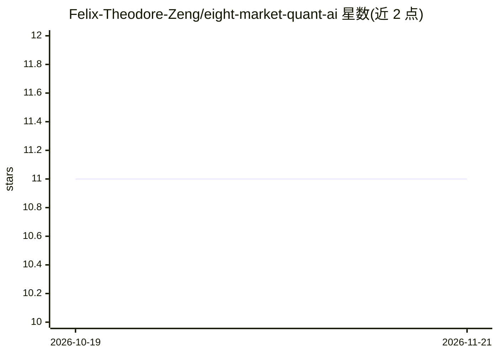

# Felix-Theodore-Zeng/eight-market-quant-ai

⭐ 11 · Python · 推送 2026-09-04 · [GitHub](https://github.com/Felix-Theodore-Zeng/eight-market-quant-ai) · 个人维护 · 中文 README

**面向八市场量化的数据采集与 AI 条件预测系统**

覆盖美国、中国 A 股、香港、加密货币、能源、贵金属、农产品与外汇八个市场的量化分析系统：以 DuckDB 建点时历史库，计算区间收益、波动率、经验分位、MDD、OLS 斜率等指标，并做机械化支撑阻力、波浪候选与斐波那契分析。AI 部分通过 Hermes 模型 fallback 链生成中文市场分析与 1日/1周/1月/3月条件预测，写入预测台账并按真实观测到期评价、月度校准。要求 Python 3.10+，TradingView 备用适配器另需 Node.js 与 pnpm；生产日报依赖 Hermes 与 Telegram 转发器。声明用于研究而非自动交易指令。

## 筛选速览

| 维度 | 判定 | 备注 |
|---|---|---|
| AI 角色 | `ai-native` | 本体是模型或模型工具 |
| 许可风险 | `none` | — |
| 部署形态 | `library` | 以包/库形式分发 |
| 模型依赖 | — | README 未给出锁定关系 |
| 硬件要求 | — | 无带数字的原话,不猜 |
| 安装摩擦 | `low` | 无编译、无系统依赖或容器化 |
| 成熟度 | — | 结构信号不足 |

## 能力要点

- DuckDB 点时历史库，记录观测日、可用时点、来源与质量
- Hermes fallback 链驱动的中文分析，不绑定特定模型供应商
- 预测按未来第 1/5/21/63 个有效观测到期评价，月度输出 Brier score 校准报告
- 低频数据（OPEC MOMR、黑海出口）以月度口径进入分析并标注时差

## 适用场景

- 每日生成八市场量化数据包与条件预测报告
- 对历史预测做到期评价与月度准确率校准
- 监控数据来源新鲜度与日报链路运行状态

## 场景标签

`金融量化` · 领域:学习与行业

## 证据(README 行号)

> L3: 一个以历史结构为核心的八市场数据采集、确定性量化计算与 AI 分析系统。系统覆盖美国、中国 A 股、香港、数字货币、能源、贵金属、农产品和外汇，并输出未来 1 日、1 周、1 月、3 月的条件预测。
> L13: - Hermes 模型 fallback 链驱动的中文分析，不在代码中绑定特定模型或供应商。

## 星数曲线

2026-10-19 11 → 2026-11-21 11（+0）

---
*卡片 v1 · prompt 1.4 · 生成 2026-11-19 · 置信度 mid · 依据 README sha `f9b4938d3ca8` · [字段定义](../../DATASET.md)*
