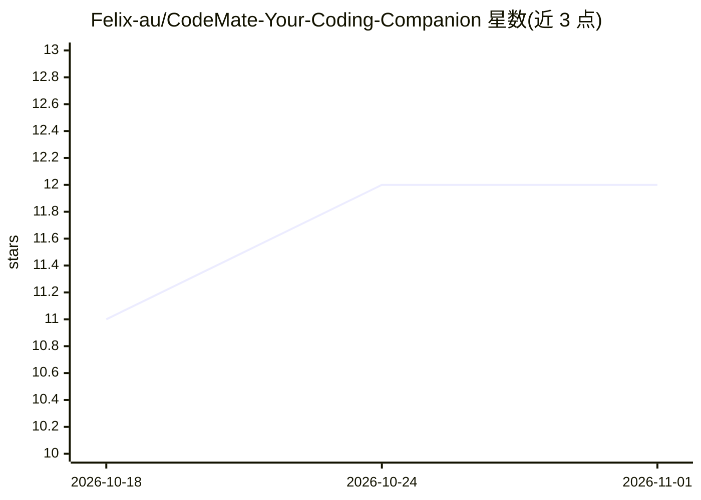

# Felix-au/CodeMate-Your-Coding-Companion

⭐ 12 · Jupyter Notebook · MIT · 推送 2026-07-23 · [GitHub](https://github.com/Felix-au/CodeMate-Your-Coding-Companion) · 个人维护

**Windows 剪贴板代码分析助手：复制代码一键获得本地 AI 调试与讲解**

面向个人开发者的 Windows 桌面应用：通过 Win32 原生剪贴板钩子检测代码片段，点击光标旁浮窗即用本地 Qwen2.5-Coder-1.5B-Instruct（QLoRA 微调适配器）进行错误检测与逐步讲解，推理前并行抓取 Wikipedia/StackOverflow 补充上下文。自动检测 NVIDIA(CUDA 4-bit)/AMD(ROCm)/CPU 后端，无 GPU 机器可选 Gemini Flash API 兜底。提供源码运行与独立 EXE 两种方式，首次运行下载约 3GB 模型。仅支持 Windows 10/11。

## 筛选速览

| 维度 | 判定 | 备注 |
|---|---|---|
| AI 角色 | `ai-native` | 本体是模型或模型工具 |
| 许可风险 | `permissive` | MIT |
| 部署形态 | `desktop` | 安装包/桌面程序 |
| 模型依赖 | — | README 未给出锁定关系 |
| 硬件要求 | `cpu-ok` | |
| 安装摩擦 | `medium` | 含编译或系统依赖之一 |
| 成熟度 | — | 结构信号不足 |

## 能力要点

- Win32 剪贴板钩子 + 14 正则模式识别代码，系统级触发浮窗
- 本地 Qwen2.5-Coder-1.5B + QLoRA 适配器，CUDA/ROCm/CPU 自动路由
- 推理前并行查询 Wikipedia 与 StackOverflow 生成受限 300 token 上下文
- 可选 Gemini Flash API 兜底与一键强制 CPU 模式

## 适用场景

- 在任意应用中复制代码后立即获得调试建议或逐步讲解
- 无 GPU 环境下用 Gemini API 模式分析剪贴板代码
- 在 IDE、浏览器、终端等处不打断工作流地查询代码问题

## 场景标签

`代码审查` · 领域:编码与开发

## 证据(README 行号)

> L19: **CodeMate** is a desktop AI assistant that monitors your clipboard for code snippets. The moment you copy code — f
> L50: - **Local Model**: Qwen2.5-Coder-1.5B-Instruct + custom QLoRA adapter (rank=16, $\alpha$=32).

## 星数曲线

2026-10-18 11 → 2026-11-01 12（+1）

---
*卡片 v1 · prompt 1.4 · 生成 2026-11-01 · 置信度 mid · 依据 README sha `3345a459732e` · [字段定义](../../DATASET.md)*
