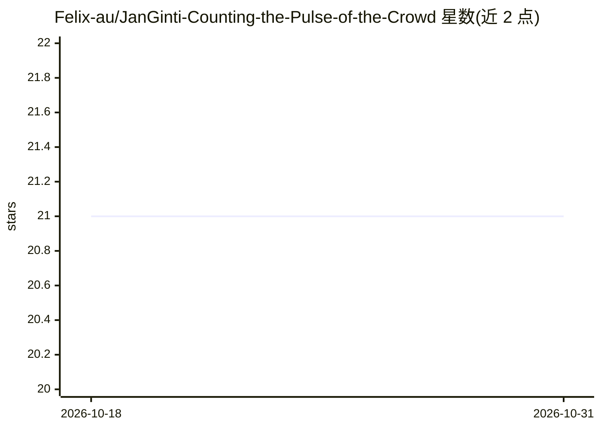

# Felix-au/JanGinti-Counting-the-Pulse-of-the-Crowd

⭐ 21 · Jupyter Notebook · MIT · 推送 2026-07-21 · [GitHub](https://github.com/Felix-au/JanGinti-Counting-the-Pulse-of-the-Crowd) · [官网](https://janginti.felixau.in) · 个人维护

**CSRNet 人群密度估计系统：训练+FastAPI 网页模拟器**

基于 CSRNet（VGG-16 前端+空洞卷积后端，16.3M 参数）的端到端人群密度估计项目：两阶段训练（ShanghaiTech Part A 从零训练，再在 A+B+自建 85 张印度人群图像 Part C 上微调），输出密度图与计数，报告 MAE/MSE 指标。部署为 FastAPI 后端（POST /predict 上传图像返回人数）加 Vite/Canvas 交互式人流模拟器前端，后端不可用时自动降级为纯模拟模式。面向计算机视觉开发者与人群管理场景用户，训练在 Colab T4 完成，附带权重文件需手动放置。

## 筛选速览

| 维度 | 判定 | 备注 |
|---|---|---|
| AI 角色 | `ai-native` | 本体是模型或模型工具 |
| 许可风险 | `permissive` | MIT |
| 部署形态 | `library` | 以包/库形式分发 |
| 模型依赖 | — | README 未给出锁定关系 |
| 硬件要求 | — | 无带数字的原话,不猜 |
| 安装摩擦 | `low` | 无编译、无系统依赖或容器化 |
| 成熟度 | — | 结构信号不足 |

## 能力要点

- 两阶段训练：ShanghaiTech Part A 基线 + A+B+C（含 85 张自建印度人群数据）微调
- FastAPI 后端提供 /predict 接口：上传图像返回人群计数与密度统计
- Canvas 交互式人流模拟器：可拖拽区域、路径动画、规则引擎、预置场景
- 逐图像评估（eval.json）与 13 项可视化（损失曲线、散点图、误差分布）

## 适用场景

- 上传人群图像获得密度估计与人数统计
- 搭建并微调自己的人群计数模型（含 Colab 训练流程）
- 在浏览器中构建与演练人群管理模拟场景
- 研究非西方场景（印度集会等）人群计数的跨域表现

## 场景标签

`微调` · 领域:训练与推理

## 证据(README 行号)

> L25: **JanGinti** (Hindi: जन-गिंती — "People Counting") is an end-to-end crowd density estimation system built on the **
> L30: - **🌐 Deploys** the trained model via a FastAPI backend, powering an interactive canvas-based crowd flow simulator

## 星数曲线

2026-10-18 21 → 2026-10-31 21（+0）

---
*卡片 v1 · prompt 1.4 · 生成 2026-10-28 · 置信度 high · 依据 README sha `075c7bd3a12d` · [字段定义](../../DATASET.md)*
