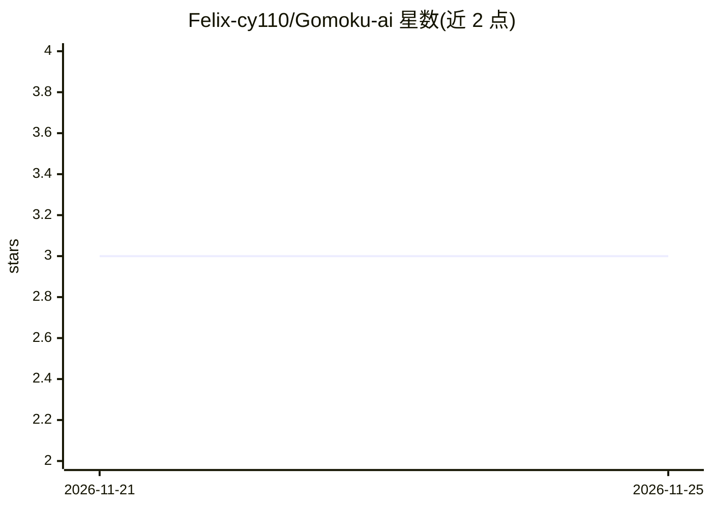

# Felix-cy110/Gomoku-ai

⭐ 3 · TypeScript · MIT · 推送 2026-11-08 · [GitHub](https://github.com/Felix-cy110/Gomoku-ai) · 个人维护 · 中文 README

**本机运行 AI 引擎对弈的五子棋桌面客户端**

基于 Electron 的五子棋桌面应用，支持人机对弈与同屏双人对弈。AI 部分调用本机运行的 Rapfi 引擎与 NNUE 模型：三档棋力对应不同搜索时间与深度，每次落子后由模型输出黑胜/白胜/和棋概率并绘制胜率曲线，支持悔棋与历史手数回看。当前仅提供源码运行方式，支持 Windows x64 与 Apple Silicon Mac，未提供安装包；浏览器预览仅支持双人棋局，不含本机 AI 分析。

## 筛选速览

| 维度 | 判定 | 备注 |
|---|---|---|
| AI 角色 | `ai-enhanced` | 去掉 AI 部分产品仍成立 |
| 许可风险 | `permissive` | MIT |
| 部署形态 | `desktop` | 安装包/桌面程序 |
| 模型依赖 | — | README 未给出锁定关系 |
| 硬件要求 | — | 无带数字的原话,不猜 |
| 安装摩擦 | `medium` | 含编译或系统依赖之一 |
| 成熟度 | — | 结构信号不足 |

## 能力要点

- 本机 Rapfi 引擎（NNUE 模型）对弈，无需账号与 API Key
- 三档棋力（不同搜索时间与深度），支持执黑或执白
- 落子后实时更新并绘制三种胜率概率曲线，可回看历史手数
- 同屏双人对弈模式，悔棋与获胜连线动画

## 适用场景

- 想在自己的电脑上与 AI 引擎下五子棋
- 没有网络或不想使用云端服务时进行人机对弈
- 与朋友共用一台电脑轮流对弈
- 通过胜率曲线观察每手棋对局面的影响

## 场景标签

 · 领域:游戏/桌面工具

## 证据(README 行号)

> L7: 一款在本机运行的五子棋桌面应用。木色棋盘、黑白落子，把时间留给下一步。
> L63: |系统|Windows x64（CPU 支持 SSE4.1），或 Apple Silicon Mac（macOS 14+）；无需独立显卡、CUDA 或 Python|
> L103: - **本地运行**：不需要登录，不使用云端模型服务。浏览器可双人对弈，本机 AI 功能需要 Windows x64 或 Apple Silicon Mac 上的桌面客户端。

## 星数曲线

2026-11-21 3 → 2026-11-25 3（+0）

---
*卡片 v1 · prompt 1.4 · 生成 2026-11-22 · 置信度 high · 依据 README sha `f7ba2944c71a` · [字段定义](../../DATASET.md)*
