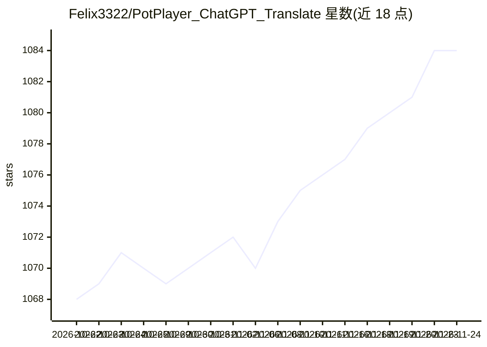

# Felix3322/PotPlayer_ChatGPT_Translate

⭐ 1,084 · AngelScript · GPL-3.0 · 推送 2026-11-01 · [GitHub](https://github.com/Felix3322/PotPlayer_ChatGPT_Translate) · 个人维护 · 中文 README

**为 PotPlayer 用户提供实时字幕翻译的 AI 插件**

PotPlayer 字幕翻译插件（AngelScript 脚本），通过 OpenAI 兼容的 chat/completions API 将字幕文本发送给模型，并在播放器内返回译文。提供带上下文与不带上下文两种脚本变体；模型名、API 地址、密钥、延迟、重试、上下文条数、缓存、小模型提示、幻觉检查等以 | 分隔写在模型名字段中配置。普通用户通过 Release 安装包安装，源码版本定位为开发测试，仓库说明并非所有源码路径都经完整测试。

## 筛选速览

| 维度 | 判定 | 备注 |
|---|---|---|
| AI 角色 | `ai-native` | 本体是模型或模型工具 |
| 许可风险 | `viral` | GPL-3.0 |
| 部署形态 | `desktop` | 安装包/桌面程序 |
| 模型依赖 | locked-api |  |
| 硬件要求 | — | 无带数字的原话,不猜 |
| 安装摩擦 | `low` | 无编译、无系统依赖或容器化 |
| 成熟度 | — | 结构信号不足 |

## 能力要点

- OpenAI 兼容 API 接入，自定义 API base URL 与无密钥端点（nullkey）支持
- 带/不带上下文两种脚本变体，可配置上下文条数与缓存模式
- 本地部署示例：qwen2.5:7b 指向 127.0.0.1:11434 的 OpenAI 兼容端点
- 可选幻觉长度检查：译文超源字幕 5 倍即重试

## 适用场景

- 看外语视频时实时翻译字幕
- 用本地部署的 OpenAI 兼容模型离线翻译字幕
- 为 DeepSeek 等 OpenAI 兼容云服务配置字幕翻译

## 场景标签

`AI 写作` · 领域:内容生成

## 证据(README 行号)

> L57: **PotPlayer_ChatGPT_Translate** is a subtitle translation plugin for PotPlayer.
> L59: It sends subtitle text to an AI model through an OpenAI-compatible API endpoint and returns translated subtitles di
> L66: This project is not limited to OpenAI models. Any model or service that follows a compatible `chat/completions` API

## 星数曲线

2026-10-22 1,068 → 2026-11-24 1,084（+16）

---
*卡片 v1 · prompt 1.4 · 生成 2026-11-24 · 置信度 high · 依据 README sha `3dc87c626915` · [字段定义](../../DATASET.md)*
