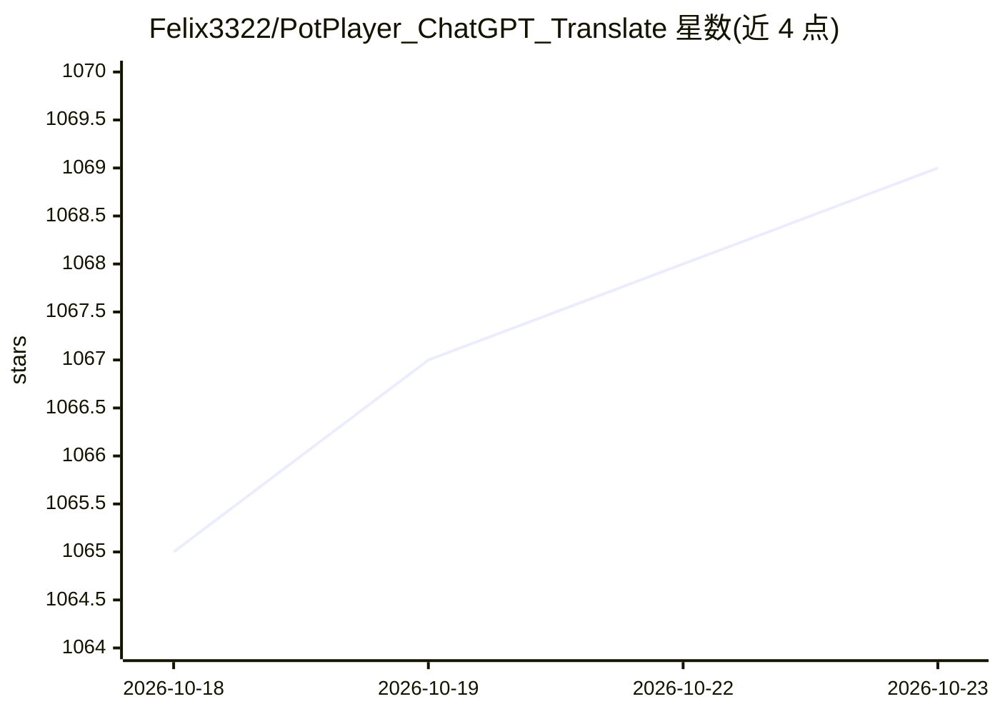

# Felix3322/PotPlayer_ChatGPT_Translate

⭐ 1,069 · C++ · GPL-3.0 · 推送 2026-10-16 · [GitHub](https://github.com/Felix3322/PotPlayer_ChatGPT_Translate) · 个人维护 · 中文 README

**给视频观众：PotPlayer 内实时 AI 字幕翻译插件**

PotPlayer 字幕翻译插件（AngelScript 脚本），将字幕文本发送到任意 OpenAI 兼容 API 端点（chat/completions 格式），翻译结果直接显示在 PotPlayer 内。提供带上下文与不带上下文两种脚本变体，支持自定义 API Base URL、无密钥端点（nullkey）、重试、请求延迟、上下文缓存、小模型提示模式与幻觉长度检查等可选参数，另含 DeepSeek thinking 开关。安装以 installer.exe 全自动方式为主，源码版本定位为开发与测试用途。

## 筛选速览

| 维度 | 判定 | 备注 |
|---|---|---|
| AI 角色 | `ai-enhanced` | 去掉 AI 部分产品仍成立 |
| 许可风险 | `viral` | GPL-3.0 |
| 部署形态 | `desktop` | 安装包/桌面程序 |
| 模型依赖 | — | README 未给出锁定关系 |
| 硬件要求 | — | 无带数字的原话,不猜 |
| 安装摩擦 | `low` | 无编译、无系统依赖或容器化 |
| 成熟度 | `idea` | |

## 能力要点

- OpenAI 兼容 API 端点接入，支持自定义 Base URL 与无密钥端点
- 带上下文/不带上下文两种脚本变体
- 可选参数：重试、延迟、上下文缓存、小模型模式、幻觉长度检查
- installer.exe 全自动安装，自动检测 PotPlayer 插件目录

## 适用场景

- 看外语视频时在 PotPlayer 内实时翻译字幕
- 接入本地 Ollama/qwen 等无密钥端点做本地翻译
- 通过上下文模式提升对白指代、梗与双关的翻译效果

## 场景标签

 · 领域:多媒体/翻译工具

## 证据(README 行号)

> L57: **PotPlayer_ChatGPT_Translate** is a subtitle translation plugin for PotPlayer.
> L59: It sends subtitle text to an AI model through an OpenAI-compatible API endpoint and returns translated subtitles di
> L25:  A PotPlayer subtitle translation plugin powered by OpenAI-compatible AI APIs.

## 星数曲线

2026-10-18 1,065 → 2026-10-23 1,069（+4）

---
*卡片 v1 · prompt 1.4 · 生成 2026-10-21 · 置信度 high · 依据 README sha `1081b9120af4` · [字段定义](../../DATASET.md)*
