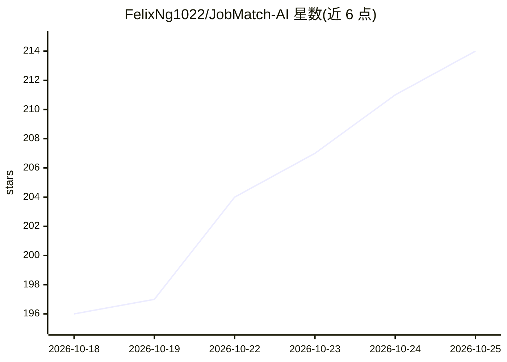

# FelixNg1022/JobMatch-AI

⭐ 216 · TypeScript · 推送 2025-12-01 · [GitHub](https://github.com/FelixNg1022/JobMatch-AI) · 个人维护

**求职者的简历-JD 匹配分析 agent，含求职信生成**

基于 CoreSpeed Zypher 框架构建的求职匹配 agent，运行在 Deno/TypeScript 上。功能包括：上传或粘贴简历后自动进行简历强度与 ATS 兼容性评分、经 Tavily 搜索并过滤 36+ 招聘网站后给出匹配职位（AI 排序前 3）、对粘贴的 JD 计算 0-100 匹配分、生成个性化求职信。LLM 通道默认 Groq（LLaMA），未配置时回退 OpenAI；API 失败时回退本地关键词解析器。通过环境变量配置 API key，deno task run:server 启动，访问 localhost:8000。

## 筛选速览

| 维度 | 判定 | 备注 |
|---|---|---|
| AI 角色 | `ai-native` | 本体是模型或模型工具 |
| 许可风险 | `none` | — |
| 部署形态 | `None` |  |
| 模型依赖 | locked-api |  |
| 硬件要求 | — | 无带数字的原话,不猜 |
| 安装摩擦 | `low` | 无编译、无系统依赖或容器化 |
| 成熟度 | — | 结构信号不足 |

## 能力要点

- JD-简历匹配度打分（0-100，基于技术技能对齐）
- Tavily 网络搜索职位并自动过滤 36+ 招聘网站，AI 排序前 3 匹配
- 简历强度与 ATS 兼容性评估，含改进建议
- 支持 PDF/DOCX/TXT 简历上传，API 失败时回退本地解析器

## 适用场景

- 投递前评估简历与 JD 的匹配度并生成求职信
- 自动发现与简历匹配的直招职位
- 检查简历质量与 ATS 兼容性

## 场景标签

`AI 写作` `文档解析` · 领域:内容生成

## 证据(README 行号)

> L5: An AI-powered job matching agent built with **CoreSpeed's Zypher framework** that intelligently analyzes job descrip
> L11: - **AI-Powered Skill Matching** - Leverages LLaMA (Meta's open-source LLM) via Groq inference API for intelligent a
> L148: - **LLaMA** (Meta's open-source LLM) - Large language model for intelligent analysis (via Groq)

## 星数曲线

2026-10-18 196 → 2026-10-25 214（+18）

---
*卡片 v1 · prompt 1.4 · 生成 2026-10-22 · 置信度 high · 依据 README sha `002dca2be2fc` · [字段定义](../../DATASET.md)*
