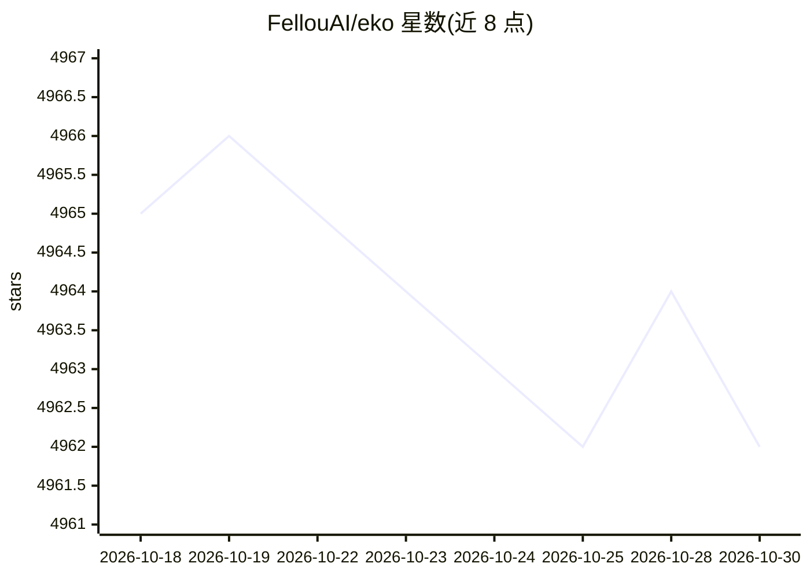

# FellouAI/eko

⭐ 4,962 · TypeScript · MIT · 推送 2026-03-03 · [GitHub](https://github.com/FellouAI/eko) · [官网](https://fellou.ai/eko) · 组织维护

**用自然语言构建生产级 Agent 工作流的 JavaScript 框架**

面向开发者的 JavaScript Agent 框架，以自然语言驱动从简单指令到多步工作流的 Agent，统一接口支持浏览器与计算机两种环境，可在浏览器扩展、Web 应用与 Node.js 中运行。提供多 Agent 协作、依赖感知并行执行、暂停/恢复/中断与 task_snapshot 恢复、MCP 连接、灵活 LLM 选择与 Human-in-the-loop 干预。通过 pnpm 安装 @eko-ai/eko 包，示例需自备模型 API key，浏览器端禁止直接放置 API key（L57-63 安全警告）。

## 筛选速览

| 维度 | 判定 | 备注 |
|---|---|---|
| AI 角色 | `ai-ecosystem` | LLM/agent 周边工具 |
| 许可风险 | `permissive` | MIT |
| 部署形态 | `library` | 以包/库形式分发 |
| 模型依赖 | — | README 未给出锁定关系 |
| 硬件要求 | — | 无带数字的原话,不猜 |
| 安装摩擦 | `low` | 无编译、无系统依赖或容器化 |
| 成熟度 | — | 结构信号不足 |

## 能力要点

- 自然语言生成多步 Agent 工作流，支持浏览器与计算机环境
- 依赖感知的多 Agent 并行执行、暂停/恢复/中断与 task_snapshot 恢复
- 一行代码自定义 Agent 与工具，原生连接 MCP Server
- 可在浏览器扩展、Web 应用、Node.js 三种环境运行

## 适用场景

- 浏览器自动化与网页抓取
- 系统文件与进程管理、GUI 自动化
- 多步任务编排与重复任务自动化
- 数据处理与整理

## 场景标签

`Agent 框架` `多智能体` `浏览器自动化` `GUI 自动化` · 领域:Agent 开发

## 证据(README 行号)

> L9: Eko (pronounced like 'echo') is a production-ready JavaScript framework that enables developers to create reliable a
> L42: - [x] Pure JavaScript: Built for browsers and Node.js.🚀
> L148: - Browser Extension

## 星数曲线

2026-10-18 4,965 → 2026-10-30 4,962（-3）

---
*卡片 v1 · prompt 1.4 · 生成 2026-10-20 · 置信度 high · 依据 README sha `fa0a07760b7b` · [字段定义](../../DATASET.md)*
