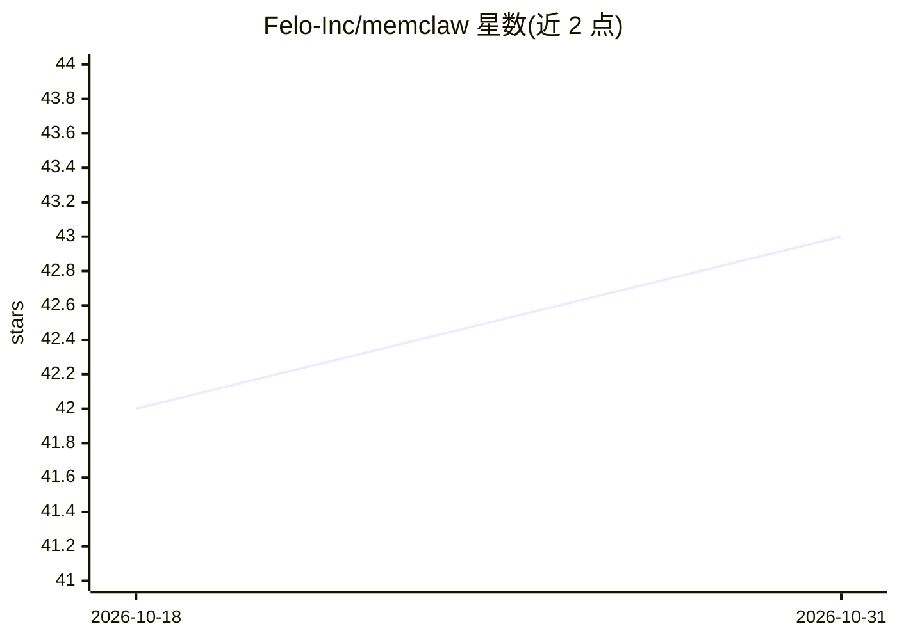

# Felo-Inc/memclaw

⭐ 43 · JavaScript · MIT · 推送 2026-04-23 · [GitHub](https://github.com/Felo-Inc/memclaw) · [官网](https://memclaw.me) · 组织维护

**给 AI 编码 agent 的持久化项目记忆系统**

面向 AI 编码 agent 的项目级持久记忆工具：每个项目对应一个隔离 workspace，存储任务、工件（报告/文档/URL/文件）和由 agent 维护的结构化项目 README；支持跨会话恢复上下文、语义检索与浏览查询，并提供 Web 仪表盘查看和管理 agent 记忆，支持邀请队友协作共享 workspace。安装需先从 felo.ai 获取 API key，可通过 Claude Code 插件市场、OpenClaw 脚本或手动 git clone 部署。核心功能免费，MIT 许可。

## 筛选速览

| 维度 | 判定 | 备注 |
|---|---|---|
| AI 角色 | `ai-ecosystem` | LLM/agent 周边工具 |
| 许可风险 | `permissive` | MIT |
| 部署形态 | `None` |  |
| 模型依赖 | — | README 未给出锁定关系 |
| 硬件要求 | — | 无带数字的原话,不猜 |
| 安装摩擦 | `low` | 无编译、无系统依赖或容器化 |
| 成熟度 | — | 结构信号不足 |

## 能力要点

- 按项目隔离的 workspace，避免跨项目上下文泄露
- Web 仪表盘查看、编辑与管理 agent 记忆
- 结构化记忆：任务、工件与 agent 维护的项目 README
- 支持团队共享 workspace 协作

## 适用场景

- 多客户咨询/销售场景下隔离管理各客户的项目记忆
- 同时维护多个代码仓库的架构与 TODO 记忆
- 把论文、笔记与洞察积累为项目级知识库

## 场景标签

`Agent 记忆` · 领域:Agent 开发

## 证据(README 行号)

> L18: **MemClaw fixes this.** It gives your AI agent a persistent, project-isolated memory system with a web dashboard so
> L36: - **Workspaces** — one project = one workspace, identified by name. Client A's context never touches Client B's.
> L65: ### Claude Code

## 星数曲线

2026-10-18 42 → 2026-10-31 43（+1）

---
*卡片 v1 · prompt 1.4 · 生成 2026-10-25 · 置信度 high · 依据 README sha `f90fff95db07` · [字段定义](../../DATASET.md)*
