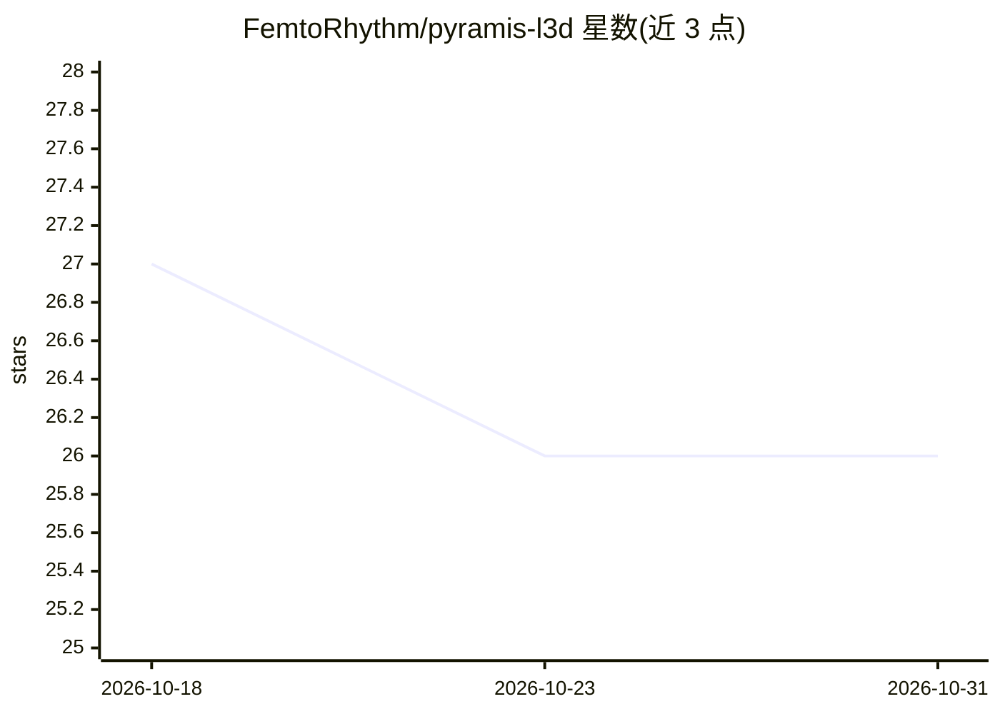

# FemtoRhythm/pyramis-l3d

⭐ 26 · Python · Apache-2.0 · 推送 2026-09-03 · [GitHub](https://github.com/FemtoRhythm/pyramis-l3d) · 个人维护 · 中文 README

**三层金字塔稀疏注意力研究原型，面向亚线性 KV 缓存**

受 CPU 多级缓存与 TLB 启发的注意力机制研究原型：将 KV 组织为 L1 稠密 GQA、L2 CNN 池化压缩、L3 可寻址码本三层层级，配合 Latent-TLB 稀疏路由仅激活 top_k 命中行，实现 O(k) 查询复杂度与亚线性 KV 存储。仓库仅含代码，权重托管在 Hugging Face，可通过 transformers trust_remote_code 加载。提供训练/评估脚本与对比 MLA 注意力的基准。README 明确声明为研究原型：字符级分词器、短训练无泛化保证、码本利用率低（约 0.2%）。

## 筛选速览

| 维度 | 判定 | 备注 |
|---|---|---|
| AI 角色 | `ai-native` | 本体是模型或模型工具 |
| 许可风险 | `permissive` | Apache-2.0 |
| 部署形态 | `library` | 以包/库形式分发 |
| 模型依赖 | — | README 未给出锁定关系 |
| 硬件要求 | — | 无带数字的原话,不猜 |
| 安装摩擦 | `low` | 无编译、无系统依赖或容器化 |
| 成熟度 | `idea` | |

## 能力要点

- L1/L2/L3 三层 KV 缓存层级，行池在 ctx 增长下保持恒定（饱和于 1472 行）
- Latent-TLB 查询时稀疏路由，仅激活 top_k 命中行，O(k) 复杂度
- 提供对比 DeepSeek-V2 风格 MLA 的基准脚本（uv 环境）
- 权重与代码开放，Apache 2.0 许可

## 适用场景

- 研究层级/稀疏注意力机制在长上下文下的 KV 缓存压缩
- 复现 PPL 与行池扩展性实验结果
- 作为稀疏注意力架构的实验起点做进一步开发

## 场景标签

`模型训练` · 领域:训练与推理

## 证据(README 行号)

> L7: Pyramis-L3D is a **hierarchical / sparse attention** research prototype. Inspired by CPU multi-level caches (L1/L2/L
> L53: model = AutoModelForCausalLM.from_pretrained(
> L70: # Train (character-level tokenizer, reads cached IMDB parquet)

## 星数曲线

2026-10-18 27 → 2026-10-31 26（-1）

---
*卡片 v1 · prompt 1.4 · 生成 2026-10-26 · 置信度 mid · 依据 README sha `7968c90d8f66` · [字段定义](../../DATASET.md)*
