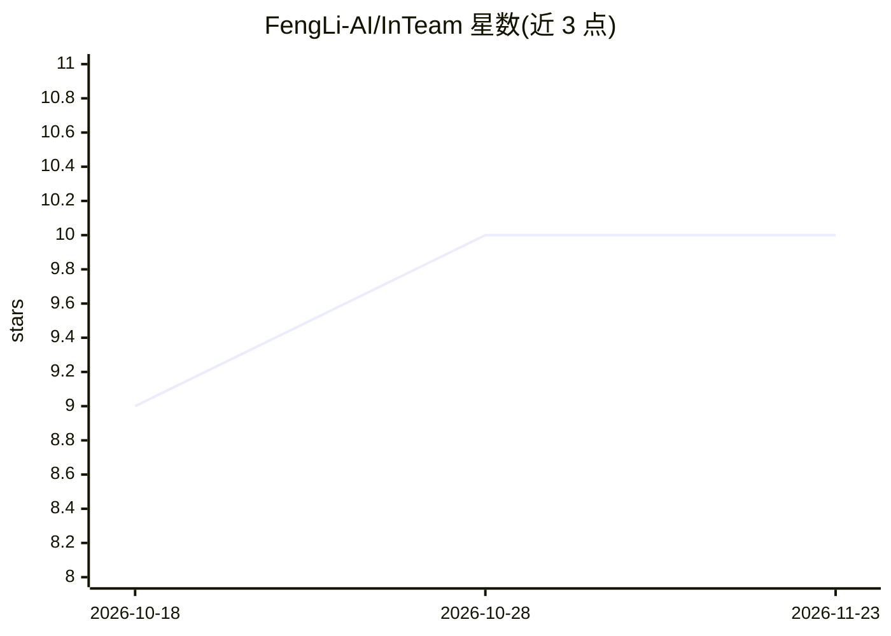

# FengLi-AI/InTeam

⭐ 10 · Python · MIT · 推送 2026-10-21 · [GitHub](https://github.com/FengLi-AI/InTeam) · [官网](https://sfvkljsfbadvdk8ub5h00.apigateway-cn-beijing.volceapi.com/) · 个人维护 · 中文 README

**面向中小企业的知识问答与办公文件生成 Agent**

InTeam 是一个自托管的企业工作空间应用：企业问答经由 Dify Chatflow 检索资料并流式回答；办公助手通过后端 Agent Loop 让模型决定继续检索、阅读全文、澄清需求或交付，再由固定工作流与程序生成可编辑的 Word/Excel 文件。报价、加班、报销等场景先核对输入、缺失字段向用户补问，关键文件按版本保存并需人工确认下载。需自备 Python 3.11、Node.js 22 环境与 Dify 及模型 API 密钥；办公任务运行器为单进程，PPT/PDF 生成等尚未支持。

## 筛选速览

| 维度 | 判定 | 备注 |
|---|---|---|
| AI 角色 | `ai-native` | 本体是模型或模型工具 |
| 许可风险 | `permissive` | MIT |
| 部署形态 | `library` | 以包/库形式分发 |
| 模型依赖 | — | README 未给出锁定关系 |
| 硬件要求 | — | 无带数字的原话,不猜 |
| 安装摩擦 | `low` | 无编译、无系统依赖或容器化 |
| 成熟度 | — | 结构信号不足 |

## 能力要点

- RAG 企业问答：Dify Chatflow 检索 + FastAPI 网关流式输出与空检索保护
- Agent Loop 自主检索决策，生成可编辑 Word/Excel（python-docx/XlsxWriter）
- 文件按版本保存并绑定 SHA-256，关键版本需用户确认
- 引用核对检查资料实际读取与引文来源

## 适用场景

- 员工查询报销、权限等企业制度问题
- 自动生成活动策划方案、报价 Excel
- 整理加班/报销申请单并逐版确认下载

## 场景标签

`RAG` `文档问答` `AI 写作` · 领域:内容生成

## 证据(README 行号)

> L3: InTeam 是面向中小企业的**企业知识问答与办公任务 Agent**。员工可以在同一个工作空间查阅企业资料、整理准备清单，也可以生成活动方案、报价表和申请单，继续修改、预览并确认下载。
> L37: - **自由任务**：后端 Agent Loop 让模型根据工具结果决定继续检索、阅读全文、澄清需求或交付准备材料。

## 星数曲线

2026-10-18 9 → 2026-11-23 10（+1）

---
*卡片 v1 · prompt 1.4 · 生成 2026-11-20 · 置信度 high · 依据 README sha `97f34fd76c90` · [字段定义](../../DATASET.md)*
