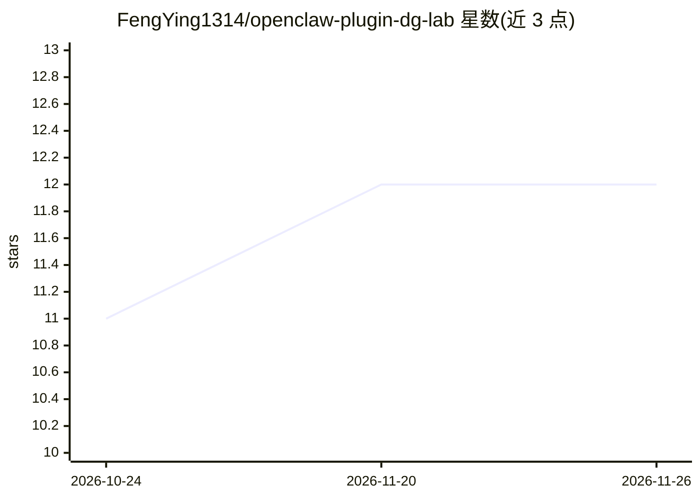

# FengYing1314/openclaw-plugin-dg-lab

⭐ 12 · TypeScript · MIT · 推送 2026-03-27 · [GitHub](https://github.com/FengYing1314/openclaw-plugin-dg-lab) · 个人维护 · 中文 README

**OpenClaw 插件：通过 WebSocket 控制郊狼 DG-Lab V3 电刺激设备**

为 OpenClaw 平台提供的 TypeScript 插件，通过内置 WebSocket 服务器与 DG-Lab（郊狼）V3 电刺激设备官方 App 建立连接。提供二维码配对、AI 工具调用（dg_shock/dg_pulse_list）、关键词触发的情感引擎、强度软上限、1 小时自动断电休息、波形文件导入（兼容 Coyote-Game-Hub 格式）等机制。环境要求 OpenClaw 2026.1+、郊狼 V3 设备与官方 App、有公网 IP 的服务器。README 开头含详细安全声明，注明作者不对使用后果承担责任。

## 筛选速览

| 维度 | 判定 | 备注 |
|---|---|---|
| AI 角色 | `ai-enhanced` | 去掉 AI 部分产品仍成立 |
| 许可风险 | `permissive` | MIT |
| 部署形态 | `library` | 以包/库形式分发 |
| 模型依赖 | — | README 未给出锁定关系 |
| 硬件要求 | — | 无带数字的原话,不猜 |
| 安装摩擦 | `low` | 无编译、无系统依赖或容器化 |
| 成熟度 | — | 结构信号不足 |

## 能力要点

- AI 工具 dg_shock/dg_pulse_list 可直接控制电刺激强度与波形
- 情感引擎按 AI 回复关键词（惩罚/生气/安抚）自动触发或减弱刺激
- 二维码配对连接 DG-Lab 官方 App，实时同步设备强度与硬件上限
- 支持导入 .pulses/.json5/.json 自定义波形，兼容 Coyote-Game-Hub 格式

## 适用场景

- 在 OpenClaw 聊天中通过指令或 AI 工具控制郊狼 V3 设备
- 导入自定义波形并在指定通道播放
- 设置强度软上限与自动休息时间做安全约束

## 场景标签

 · 领域:硬件控制/物联网外设

## 证据(README 行号)

> L10: 一个 OpenClaw 插件，用于通过 WebSocket 连接并控制 **郊狼 (DG-Lab) V3** 电刺激设备。
> L31: - **情感引擎** — `/dg_emotion on` 开启后，AI 根据回复关键词自动触发刺激
> L44: - 有公网 IP 的服务器（或端口转发）

## 星数曲线

2026-10-24 11 → 2026-11-26 12（+1）

---
*卡片 v1 · prompt 1.4 · 生成 2026-11-19 · 置信度 high · 依据 README sha `cad227a3005b` · [字段定义](../../DATASET.md)*
