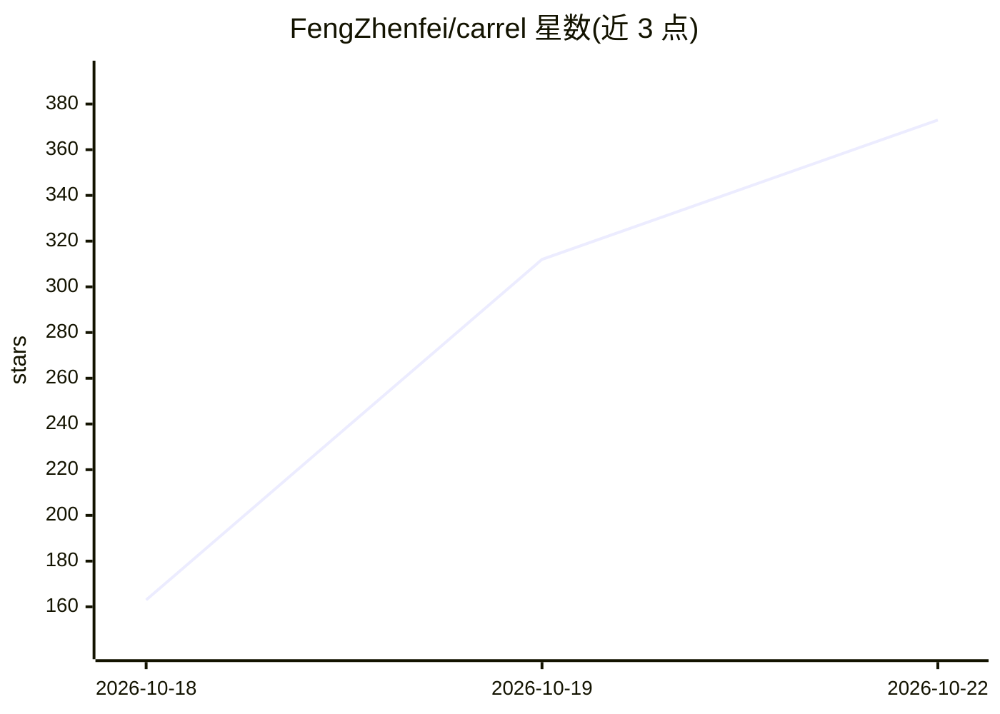

# FengZhenfei/carrel

⭐ 462 · Python · MIT · 推送 2026-10-22 · [GitHub](https://github.com/FengZhenfei/carrel) · 个人维护 · 中文 README

**面向 AI agent 的自托管知识库：文档解析、索引与检索**

自托管的知识库服务，自动化文档解析、索引与检索，可选构建知识图谱。Agent 通过其 API 检索来源段落、图片与关联事实后自行生成回答。技术栈：MinerU 与原生解析器做摄取，Qdrant 向量、OpenSearch 关键词、Neo4j 图查询，SQLite 记录文件与任务；模型可本地运行或接兼容托管端点。需 Python 3.12+、Docker 25+ 与 Compose v2，Windows 仅支持 WSL2。自带 Web 控制台与供 Claude Code、Codex 使用的搜索技能。

## 筛选速览

| 维度 | 判定 | 备注 |
|---|---|---|
| AI 角色 | `ai-ecosystem` | LLM/agent 周边工具 |
| 许可风险 | `permissive` | MIT |
| 部署形态 | `self-host` | docker 或自建部署 |
| 模型依赖 | — | README 未给出锁定关系 |
| 硬件要求 | — | 无带数字的原话,不猜 |
| 安装摩擦 | `low` | 无编译、无系统依赖或容器化 |
| 成熟度 | — | 结构信号不足 |

## 能力要点

- 支持 PDF/Word/PPT/表格/图片/HTML/Markdown/源码解析
- 向量、关键词、图与视觉搜索的混合检索，可选重排
- 从文档抽取实体、关系与事实并保留来源、时间与冲突指示
- 定时任务扫描文件变更并自动更新索引与知识图谱

## 适用场景

- 让 Claude Code / Codex 等 agent 检索我的产品文档与会议记录
- 搭建带知识图谱的私有文档知识库供 agent 查询
- 通过 Web 控制台管理多个知识库与模型端点

## 场景标签

`RAG` `文档解析` `知识图谱` · 领域:知识与检索

## 证据(README 行号)

> L9: Carrel is a self-hosted knowledge base for AI agents. It automates document
> L11: its API to retrieve source passages, images, and related facts, then generate

## 星数曲线

2026-10-18 163 → 2026-10-22 373（+210）

---
*卡片 v1 · prompt 1.4 · 生成 2026-10-22 · 置信度 high · 依据 README sha `85e3a780411b` · [字段定义](../../DATASET.md)*
