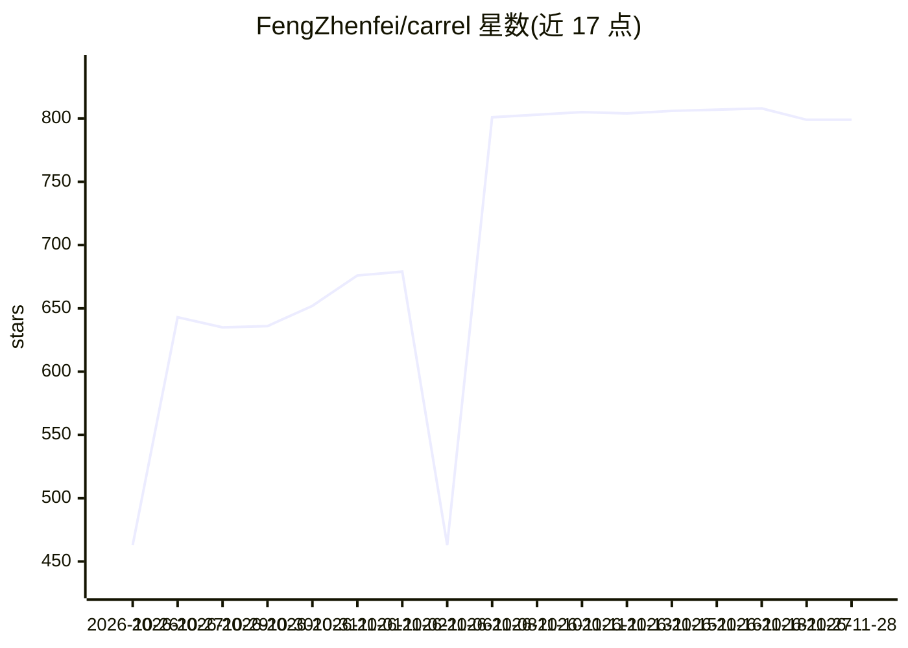

# FengZhenfei/carrel

⭐ 799 · Python · MIT · 推送 2026-11-22 · [GitHub](https://github.com/FengZhenfei/carrel) · 个人维护 · 中文 README

**自托管的 AI agent 知识库：文档解析、检索与知识图谱**

自托管的知识库服务，自动完成文档解析、索引与检索，并可选构建知识图谱；agent 通过其搜索 API 获取来源片段、图片与图谱事实后自行生成回答。提供 Standard（Qdrant/OpenSearch/Neo4j）与 Light（内嵌 LanceDB/DuckDB）两种部署版，内置 Web 控制台管理知识库、模型端点与任务，附带可安装到 Claude Code、Codex 等 agent 的搜索 skill。部署依赖 Docker Compose，模型服务需自行配置端点。

## 筛选速览

| 维度 | 判定 | 备注 |
|---|---|---|
| AI 角色 | `ai-ecosystem` | LLM/agent 周边工具 |
| 许可风险 | `permissive` | MIT |
| 部署形态 | `self-host` | docker 或自建部署 |
| 模型依赖 | — | README 未给出锁定关系 |
| 硬件要求 | — | 无带数字的原话,不猜 |
| 安装摩擦 | `low` | 无编译、无系统依赖或容器化 |
| 成熟度 | — | 结构信号不足 |

## 能力要点

- 混合检索：向量、关键词、图谱与视觉搜索及重排融合
- 从文档提取实体、关系与事实，保留来源、时间与冲突标记
- Standard/Light 两种存储版（Qdrant+OpenSearch+Neo4j 或内嵌 LanceDB+DuckDB）
- 内置 carrel-search skill 与带 token 鉴权的搜索 API

## 适用场景

- 让 agent 检索产品文档、合同、会议记录等持续变化的文件
- 为本地文档构建带来源溯源的知识图谱
- 自托管环境下搭建 RAG 检索服务供多个 agent 调用

## 场景标签

`文档解析` `知识图谱` `RAG` · 领域:知识与检索

## 证据(README 行号)

> L9: Carrel is a self-hosted knowledge base for AI agents. It automates document
> L10: parsing, indexing, and retrieval, with optional knowledge graphs. Agents use
> L39: - **Agent access:** search through an API, fetch surrounding text or original

## 星数曲线

2026-10-26 463 → 2026-11-28 799（+336）

---
*卡片 v1 · prompt 1.4 · 生成 2026-11-24 · 置信度 high · 依据 README sha `f36b7b6880fe` · [字段定义](../../DATASET.md)*
