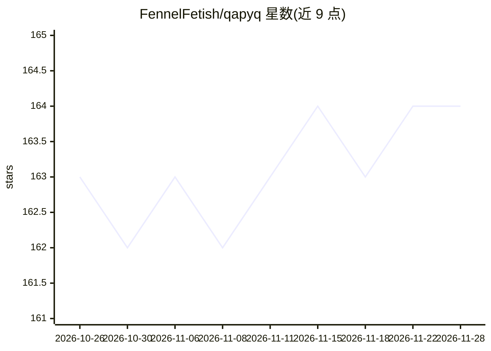

# FennelFetish/qapyq

⭐ 164 · Python · AGPL-3.0 · 推送 2026-11-27 · [GitHub](https://github.com/FennelFetish/qapyq) · 个人维护

**为大图像/视频数据集做AI标注、裁剪、遮罩的桌面工具，服务LoRA训练**

基于 Qt 的桌面应用，面向大规模图像/视频数据集的整理与训练数据准备：提供媒体浏览、排序过滤、快速裁剪、多图层遮罩编辑、批量打标与改写等。AI 机制：本地或经 SSH 远程运行打标/描述/遮罩/放大模型，支持 GGUF 量化、GPU 加速与 CPU offload，推理在独立子进程执行以隔离崩溃并清理显存。可安装为纯 GUI 模式（不含 AI 组件）。

## 筛选速览

| 维度 | 判定 | 备注 |
|---|---|---|
| AI 角色 | `ai-native` | 本体是模型或模型工具 |
| 许可风险 | `viral` | AGPL-3.0 |
| 部署形态 | `None` |  |
| 模型依赖 | local-ok | 支持本地模型 |
| 硬件要求 | — | 无带数字的原话,不猜 |
| 安装摩擦 | `medium` | 含编译或系统依赖之一 |
| 成熟度 | — | 结构信号不足 |

## 能力要点

- 支持 JoyTag、Florence-2、Qwen2.5-VL、InternVL3 等多种打标/描述/遮罩模型架构
- 本地与多台远程机器 SSH 推理，独立子进程隔离崩溃并清理 VRAM
- NF4/INT8 即时量化与 GGUF 模型加载
- 百万级文件的批量管理、过滤与批处理工作流

## 适用场景

- 为 LoRA/扩散模型训练批量生成图像描述与标签
- 训练前裁剪素材并生成遮罩
- 按语义提示对大型数据集排序与筛选子集

## 场景标签

`图像视频处理` `目标检测` `微调` · 领域:感知与多模态

## 证据(README 行号)

> L3: **AI-assisted media curator for large image/video datasets. Streamlined captioning, cropping, masking for LoRA/diffu
> L71: - **🔮 AI Assistance**:
> L75:  - Run inference locally and/or on multiple remote machines over SSH ?

## 星数曲线

2026-10-26 163 → 2026-11-28 164（+1）

---
*卡片 v1 · prompt 1.4 · 生成 2026-11-27 · 置信度 high · 依据 README sha `0fed36e71baa` · [字段定义](../../DATASET.md)*
