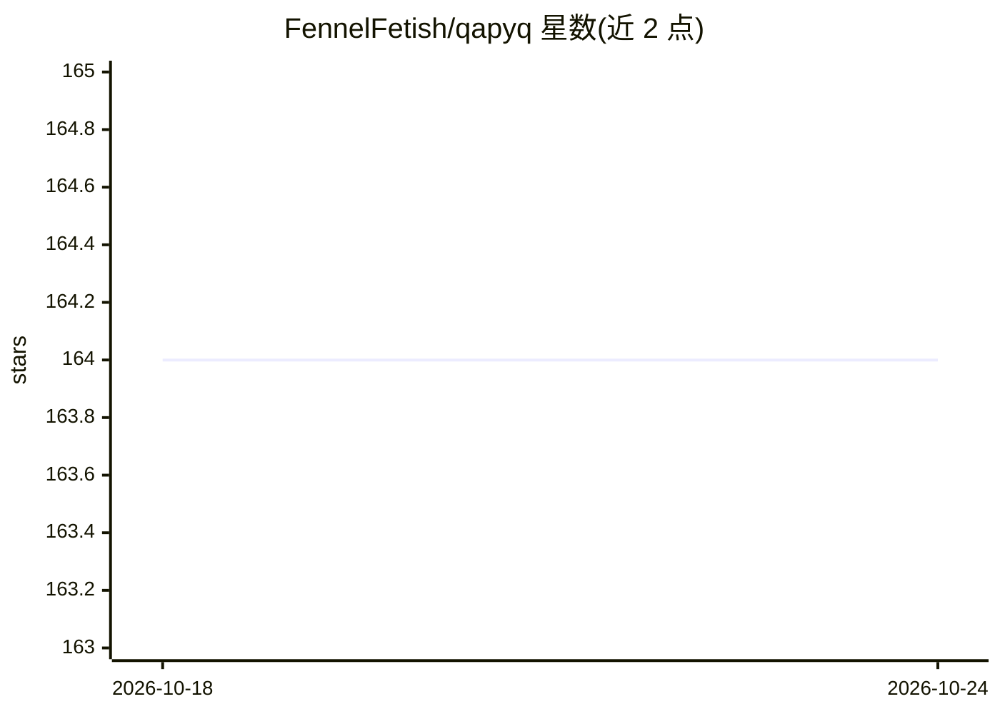

# FennelFetish/qapyq

⭐ 164 · Python · AGPL-3.0 · 推送 2026-10-20 · [GitHub](https://github.com/FennelFetish/qapyq) · 个人维护

**面向 LoRA/扩散训练的图像视频数据集 AI 策展桌面工具**

基于 Qt 的桌面应用，用于为 LoRA/扩散模型训练准备大规模图像与视频数据集：提供媒体浏览（支持百万级文件）、裁剪/缩放/VAE 编码预览、手动与 AI 生成遮罩、手动及自动打标与描述生成、标签规则变换、统计过滤与批量处理。AI 部分支持打标、描述、LLM 变换、超分、检测分割、嵌入排序等多类模型，含 GGUF 本地推理、NF4/INT8 量化与 SSH 远程推理。需 Python 3.10+，通过 setup 脚本安装到虚拟环境，可选 CUDA/ROCm/CPU 平台。

## 筛选速览

| 维度 | 判定 | 备注 |
|---|---|---|
| AI 角色 | `ai-native` | 本体是模型或模型工具 |
| 许可风险 | `viral` | AGPL-3.0 |
| 部署形态 | `None` |  |
| 模型依赖 | local-ok | 支持本地模型 |
| 硬件要求 | — | 无带数字的原话,不猜 |
| 安装摩擦 | `medium` | 含编译或系统依赖之一 |
| 成熟度 | — | 结构信号不足 |

## 能力要点

- 自动打标与描述生成，支持多轮 VLM 对话及 LLM 后处理
- AI 生成遮罩（YOLO 检测、Florence-2、RMBG-2.0 分割等）
- GGUF 模型本地运行、NF4/INT8 即时量化、SSH 远程推理
- 标签规则变换、统计过滤与整文件夹批量处理

## 适用场景

- 为 LoRA/扩散模型训练整理并标注图像视频数据集
- 批量生成与精修图片描述和标签
- 为训练数据制作遮罩并做数据统计过滤

## 场景标签

`图像视频处理` `目标检测` · 领域:感知与多模态

## 证据(README 行号)

> L3: **AI-assisted media curator for large image/video datasets. Streamlined captioning, cropping, masking for LoRA/diffu
> L53:  - Automated captioning with support for grounding ?
> L72:  - Support for state-of-the-art captioning and masking models

## 星数曲线

2026-10-18 164 → 2026-10-24 164（+0）

---
*卡片 v1 · prompt 1.4 · 生成 2026-10-22 · 置信度 high · 依据 README sha `3dd547315555` · [字段定义](../../DATASET.md)*
