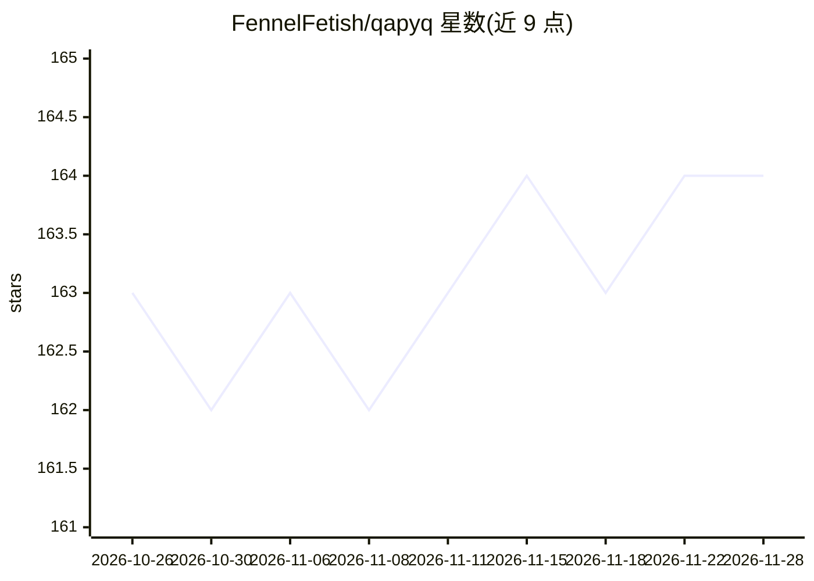

# FennelFetish/qapyq

⭐ 164 · Python · AGPL-3.0 · 推送 2026-11-27 · [GitHub](https://github.com/FennelFetish/qapyq) · 个人维护

**大型图像/视频数据集的 AI 辅助标注与整理桌面工具**

基于 Qt 的桌面应用，面向 LoRA/diffusion 训练工作流，为大规模图像与视频数据集提供打标、裁剪、掩码与整理功能。支持百万级文件浏览、多窗口多标签界面、批量处理与 CSV 导出；AI 部分支持本地或经 SSH 的远程推理，涵盖打标、字幕生成、LLM 改写、超分、掩码分割与嵌入排序等模型架构，提供 GPU 加速、NF4/INT8 量化与独立推理子进程以隔离崩溃并释放显存。

## 筛选速览

| 维度 | 判定 | 备注 |
|---|---|---|
| AI 角色 | `ai-native` | 本体是模型或模型工具 |
| 许可风险 | `viral` | AGPL-3.0 |
| 部署形态 | `None` |  |
| 模型依赖 | local-ok | 支持本地模型 |
| 硬件要求 | — | 无带数字的原话,不猜 |
| 安装摩擦 | `medium` | 含编译或系统依赖之一 |
| 成熟度 | — | 结构信号不足 |

## 能力要点

- 支持 JoyTag、Florence-2、Qwen 系列、GGUF 模型等多类打标/字幕/掩码/超分架构
- 本地推理与多台远程机器 SSH 推理，独立子进程隔离崩溃并清理 VRAM
- 批量打标、掩码、裁剪、缩放与文件整理，支持用户自定义宏
- 语义图像排序（CLIP/SigLIP 嵌入）与 CLIP Token 计数

## 适用场景

- 为 LoRA/diffusion 训练准备图像与视频数据集的标注与掩码
- 批量管理百万级图片库并按语义排序筛选子集
- 在本地或多台远程 GPU 机器上批量生成字幕与标签

## 场景标签

`图像视频处理` `目标检测` `语义搜索` · 领域:知识与检索

## 证据(README 行号)

> L3: **AI-assisted media curator for large image/video datasets. Streamlined captioning, cropping, masking for LoRA/diffu
> L74: - **🔮 AI Assistance**:
> L78:  - Run inference locally and/or on multiple remote machines over SSH ?

## 星数曲线

2026-10-26 163 → 2026-11-28 164（+1）

---
*卡片 v1 · prompt 1.4 · 生成 2026-11-28 · 置信度 high · 依据 README sha `173c1401c2a6` · [字段定义](../../DATASET.md)*
