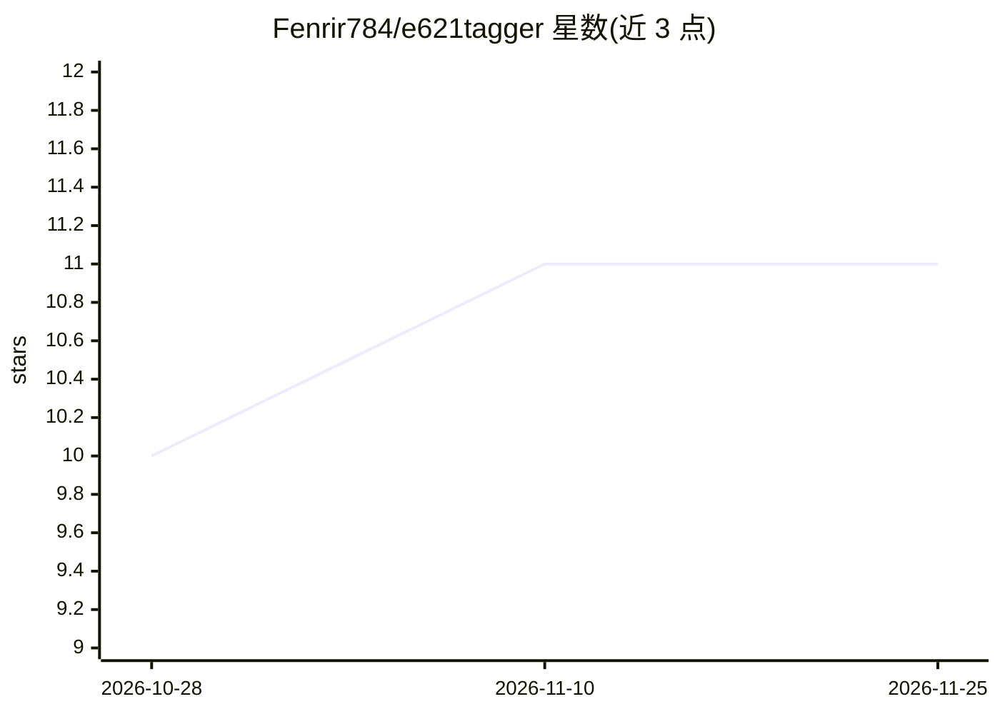

# Fenrir784/e621tagger

⭐ 11 · Python · Apache-2.0 · 推送 2026-10-12 · [GitHub](https://github.com/Fenrir784/e621tagger) · [官网](https://tagger.fenrir784.app) · 个人维护

**为 furry 作品自动生成 e621 标签的网页工具**

基于 Hydra 3.5 模型（在 e621 数据上微调的图像分类器）的网页标签生成工具：上传图片后由后端 PyTorch 推理，模型对 8,888 个可能标签输出置信度分数，用户可调节阈值控制返回的标签数量。支持 e621/PostyBirb 标签格式、e621wiki 查询、PWA 及移动/桌面界面，所有处理在服务器端完成，不向第三方发送数据。提供在线实例，也可用 docker 镜像自托管。

## 筛选速览

| 维度 | 判定 | 备注 |
|---|---|---|
| AI 角色 | `ai-native` | 本体是模型或模型工具 |
| 许可风险 | `permissive` | Apache-2.0 |
| 部署形态 | `self-host` | docker 或自建部署 |
| 模型依赖 | — | README 未给出锁定关系 |
| 硬件要求 | — | 无带数字的原话,不猜 |
| 安装摩擦 | `low` | 无编译、无系统依赖或容器化 |
| 成熟度 | — | 结构信号不足 |

## 能力要点

- Hydra 3.5 模型对 8,888 个标签输出置信度分数
- 可调节阈值控制返回标签数量
- all-in-one docker 镜像支持自托管
- 支持 e621/PostyBirb 标签格式与 PWA

## 适用场景

- 上传 furry 作品批量生成 e621 标签
- 自托管实例在本地处理标签生成
- 导出 PostyBirb 兼容的标签格式

## 场景标签

`目标检测` · 领域:感知与多模态

## 证据(README 行号)

> L3: e621tagger is a web-based tool that automatically generates relevant tags for furry artwork using the **Hydra 3.5** 
> L37: - The backend uses **PyTorch** and the **Hydra 3.5** model, a fine‑tuned image classifier trained on e621 data.

## 星数曲线

2026-10-28 10 → 2026-11-25 11（+1）

---
*卡片 v1 · prompt 1.4 · 生成 2026-11-19 · 置信度 high · 依据 README sha `2d253297d529` · [字段定义](../../DATASET.md)*
