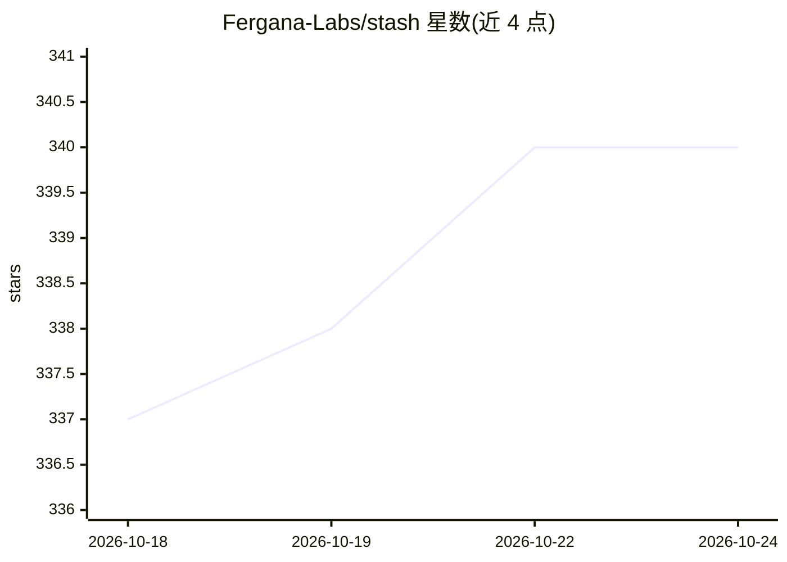

# Fergana-Labs/stash

⭐ 340 · Python · MIT · 推送 2026-10-23 · [GitHub](https://github.com/Fergana-Labs/stash) · [官网](https://www.joinstash.ai) · 组织维护

**让 coding agent 从历史经验中学习的知识与技能基础设施**

面向 agent 开发者的开源基础设施：通过 hooks 或 API 捕获生产会话轨迹，由定时 curator 从中提取持久经验并写入 Memory wiki，再以 CLI/MCP/API/虚拟文件系统供后续运行检索，或打包为含 SKILL.md 的技能并经 `stash skills install` 安装到 agent。Python SDK、REST API、MCP 与 CLI 四种访问方式，可自托管。另含奖励模型实验：从评审反馈构造偏好对训练个人奖励模型，经 GEPA 生成候选提示与技能；该功能仅对特定账户开放。

## 筛选速览

| 维度 | 判定 | 备注 |
|---|---|---|
| AI 角色 | `ai-ecosystem` | LLM/agent 周边工具 |
| 许可风险 | `permissive` | MIT |
| 部署形态 | `None` |  |
| 模型依赖 | — | README 未给出锁定关系 |
| 硬件要求 | — | 无带数字的原话,不猜 |
| 安装摩擦 | `low` | 无编译、无系统依赖或容器化 |
| 成熟度 | — | 结构信号不足 |

## 能力要点

- hooks/API 捕获 agent 会话轨迹并提取持久经验
- 经验以 CLI/MCP/API/虚拟文件系统检索，或打包为 SKILL.md 技能
- 从轨迹反馈训练个人奖励模型并用 GEPA 优化提示与技能
- Python SDK、REST API、MCP、CLI 四种访问方式，支持自托管

## 适用场景

- 把评审对 agent 输出的纠正沉淀为项目规则供后续运行使用
- 团队维护跨会话的 agent 记忆与可复用技能库
- 基于生产轨迹反馈训练奖励模型并持续优化提示词

## 场景标签

`Agent 记忆` · 领域:Agent 开发

## 证据(README 行号)

> L14: This repository provides the open-source foundation: trace collection, persistent
> L87: 1. **Capture experience.** Hooks for coding agents record prompts, tool calls,
> L93: 3. **Make lessons reusable.** Agents search and read that knowledge through the

## 星数曲线

2026-10-18 337 → 2026-10-24 340（+3）

---
*卡片 v1 · prompt 1.4 · 生成 2026-10-21 · 置信度 high · 依据 README sha `5c26addd46a7` · [字段定义](../../DATASET.md)*
