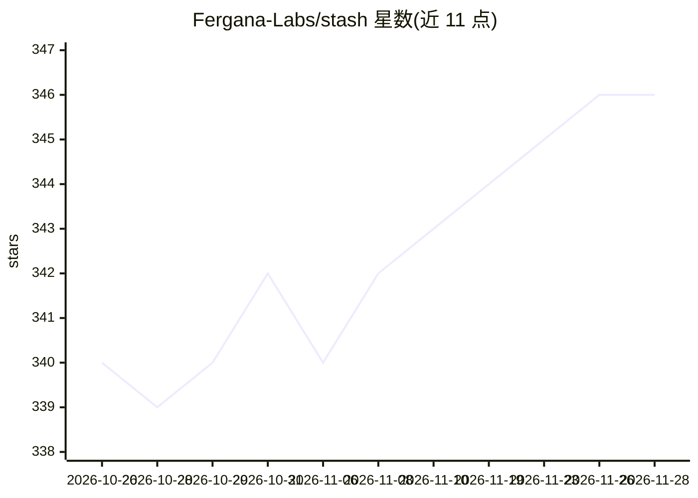

# Fergana-Labs/stash

⭐ 346 · Python · MIT · 推送 2026-11-14 · [GitHub](https://github.com/Fergana-Labs/stash) · [官网](https://www.joinstash.ai) · 组织维护

**为 agent 捕捉经验轨迹并沉淀为可复用知识与技能的基础设施**

Stash 提供开源基础设施：通过 hooks 或 API 采集 agent 运行记录与人工修正，由定时 curator 从会话中提炼持久经验并更新 Memory wiki，再经 CLI、MCP、API 或虚拟文件系统供后续运行检索；相关指令与文件可打包为含 SKILL.md 的 Skill，用 stash skills install 安装并在会话开始时自动更新，不改动模型权重。以 Python SDK、REST API、MCP、CLI 形式提供，支持自托管。

## 筛选速览

| 维度 | 判定 | 备注 |
|---|---|---|
| AI 角色 | `ai-ecosystem` | LLM/agent 周边工具 |
| 许可风险 | `permissive` | MIT |
| 部署形态 | `None` |  |
| 模型依赖 | — | README 未给出锁定关系 |
| 硬件要求 | — | 无带数字的原话,不猜 |
| 安装摩擦 | `low` | 无编译、无系统依赖或容器化 |
| 成熟度 | — | 结构信号不足 |

## 能力要点

- 捕捉 agent 会话轨迹与人工修正，沉淀为持久知识
- 定时 curator 从会话提取经验并更新 Memory wiki
- 将指令与文件打包为 SKILL.md 格式的可安装 Skill，自动随会话更新
- 提供 Python SDK、REST API、MCP 与 CLI 四种接入方式

## 适用场景

- 让编码 agent 从历史失败与修正中吸取项目规则
- 把人工审查意见固化为可复用的检查清单技能
- 团队共享 agent 经验，跨会话传递变更指令

## 场景标签

`知识库管理` `Agent 记忆` · 领域:Agent 开发

## 证据(README 行号)

> L14: This repository provides the open-source foundation: trace collection, persistent
> L16: REST API, MCP, and CLI. It works alongside your existing agents and models.

## 星数曲线

2026-10-26 340 → 2026-11-28 346（+6）

---
*卡片 v1 · prompt 1.4 · 生成 2026-11-25 · 置信度 high · 依据 README sha `f8b5f11597e6` · [字段定义](../../DATASET.md)*
