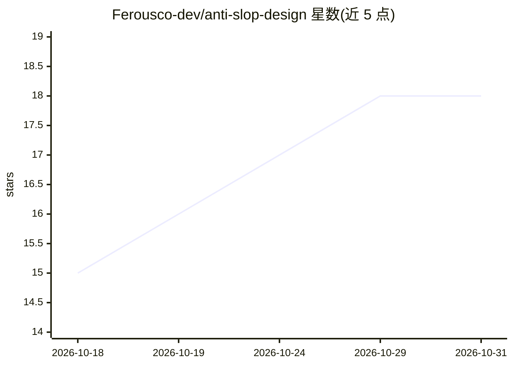

# Ferousco-dev/anti-slop-design

⭐ 18 · Python · MIT · 推送 2026-10-02 · [GitHub](https://github.com/Ferousco-dev/anti-slop-design) · 个人维护

**给 Claude 的设计规范 Skill：阻止 AI 生成千篇一律的界面**

一个 Claude Agent Skill，安装后 Claude 在生成、审查或重构 UI 时自动加载，改变模型的设计决策方式。内容包括 20 个禁止视觉模式的硬性拒绝清单、先命名视觉方向再写代码的操作协议、设计决策框架与机制层解释，并设定可访问性、性能与耐久性的底线；采用渐进披露，SKILL.md 保持小体积，深层参考模块按需加载。安装支持插件市场、git clone 复制、一键脚本与 zip 上传。

## 筛选速览

| 维度 | 判定 | 备注 |
|---|---|---|
| AI 角色 | `ai-ecosystem` | LLM/agent 周边工具 |
| 许可风险 | `permissive` | MIT |
| 部署形态 | `desktop` | 安装包/桌面程序 |
| 模型依赖 | locked-api |  |
| 硬件要求 | — | 无带数字的原话,不猜 |
| 安装摩擦 | `low` | 无编译、无系统依赖或容器化 |
| 成熟度 | — | 结构信号不足 |

## 能力要点

- 20 个模块覆盖视觉、色彩、排版、布局、动效、文案等模式
- 先命名视觉方向再写代码的操作协议与预输出自检清单
- 渐进披露：深层参考模块仅在需要时加载
- 可固定项目上下文（brief、色板、语调）避免每会话重定

## 适用场景

- 让 Claude 生成落地页/仪表盘时避开 AI 套路化设计
- 审查或重构已有界面组件的设计质量
- 移动端与 Web 项目统一设计决策流程

## 场景标签

`提示工程` · 领域:Agent 开发

## 证据(README 行号)

> L5: **A Claude Agent Skill that stops your AI from shipping the same purple-gradient website as everyone else.**
> L25: `anti-slop-design` installs as a Claude Agent Skill. Once installed, Claude loads it automatically whenever you gen

## 星数曲线

2026-10-18 15 → 2026-10-31 18（+3）

---
*卡片 v1 · prompt 1.4 · 生成 2026-10-29 · 置信度 high · 依据 README sha `05ac3dd8840a` · [字段定义](../../DATASET.md)*
