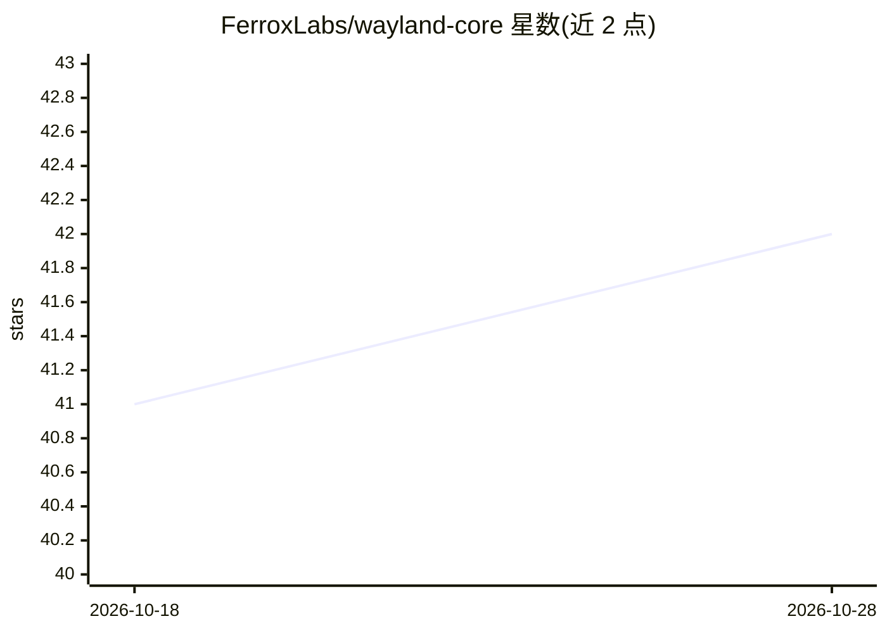

# FerroxLabs/wayland-core

⭐ 42 · Rust · Apache-2.0 · 推送 2026-10-01 · [GitHub](https://github.com/FerroxLabs/wayland-core) · [官网](https://getwayland.com) · 组织维护

**Rust 编写的多供应商自进化 AI agent 命令行引擎**

用 Rust 实现的终端优先 AI agent 引擎：单条命令、全屏 TUI 或可嵌入的无头流三种形态。通过统一的 LlmProvider trait 接入 23 个内置供应商，粘贴 API key 即可指纹识别并写入 OS 钥匙串；提供 Spawn/Swarm/Mesh/Fleet 四层编排拓扑与 git worktree 隔离的并行 worker。Crucible 让多个模型交叉审计合成答案，Anvil 以测试/构建等可执行门槛驱动迭代并出具回执，GEPA 在运行间改写并评分自身提示词。shell 执行运行于 OS 原生沙箱，出站流量经单一出口网关，双向支持 MCP。Linux 需 libseccomp2、glibc 2.34+，不支持 musl。

## 筛选速览

| 维度 | 判定 | 备注 |
|---|---|---|
| AI 角色 | `ai-native` | 本体是模型或模型工具 |
| 许可风险 | `permissive` | Apache-2.0 |
| 部署形态 | `desktop` | 安装包/桌面程序 |
| 模型依赖 | locked-api |  |
| 硬件要求 | — | 无带数字的原话,不猜 |
| 安装摩擦 | `low` | 无编译、无系统依赖或容器化 |
| 成熟度 | — | 结构信号不足 |

## 能力要点

- 23 个内置供应商，单一 LlmProvider trait 与 ProviderCompat 配置层适配差异
- 四层编排拓扑（Spawn 5 / Swarm 100 / Mesh 50 / Fleet 100），上限强制执行
- Anvil 以可执行门槛（测试/构建）驱动迭代并输出验证回执；Crucible 多模型交叉审计合成答案
- GEPA 在运行间改写并按评测重新评分自身技能提示词，仅保留胜出版本
- shell 执行运行于 seccomp 沙箱，出站调用经单一出口网关

## 适用场景

- 在终端用一条命令让 agent 读代码库、执行工具并回答问题
- 把任务扇出到多个隔离 worktree 并行跑测试再汇总结果
- 让 agent 以测试通过为门槛迭代修复失败用例并拿到验证回执
- 通过 JSON-Lines 协议把该引擎嵌入自己的应用

## 场景标签

`编码 Agent` `多智能体` `Agent 框架` · 领域:Agent 开发

## 证据(README 行号)

> L7: **Most AI tools are as good as they'll ever be the day you install them. Wayland Core isn't — it convenes a council 
> L88: - **23 built-in providers, one `--provider <slug>` switch.** The slug picks the wire, the base URL, and the compat 

## 星数曲线

2026-10-18 41 → 2026-10-28 42（+1）

---
*卡片 v1 · prompt 1.4 · 生成 2026-10-25 · 置信度 high · 依据 README sha `89e5335e7519` · [字段定义](../../DATASET.md)*
