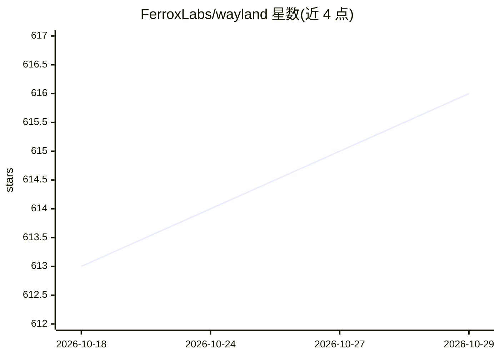

# FerroxLabs/wayland

⭐ 616 · TypeScript · AGPL-3.0 · 推送 2026-10-21 · [GitHub](https://github.com/FerroxLabs/wayland) · [官网](https://getwayland.com) · 组织维护

**本地优先的桌面 AI agent，统一驱动各 AI CLI 协同完成整项工作**

Rust/Electron 桌面应用，含内置 Fuigo 引擎：以单一命令中心驱动 Claude Code、Codex、Gemini、Qwen、Goose 等 AI CLI，密钥与文件留在本机。提供 Cowork 协作模式（文件读写、Bash 等内置工具、Plan 只读模式）、自组装多 agent 团队、178 个现成工作流、预训练领域专家助手、cron 定时任务、跨会话 SQLite 五分区记忆（工作/情景/语义/程序/用户模型）与 MCP 集成。可选接入 Flux Router 或任意 OpenAI/Anthropic/Gemini/Ollama 密钥，无强制后端。桌面安装包覆盖 macOS/Windows/Linux，另有 npm 包支持 VPS 自托管。

## 筛选速览

| 维度 | 判定 | 备注 |
|---|---|---|
| AI 角色 | `ai-native` | 本体是模型或模型工具 |
| 许可风险 | `viral` | AGPL-3.0 |
| 部署形态 | `desktop` | 安装包/桌面程序 |
| 模型依赖 | local-ok | 支持本地模型 |
| 硬件要求 | — | 无带数字的原话,不猜 |
| 安装摩擦 | `low` | 无编译、无系统依赖或容器化 |
| 成熟度 | — | 结构信号不足 |

## 能力要点

- 统一驱动 Claude Code、Codex、Gemini、Qwen、Goose 等十余个 AI CLI
- Cowork 模式含 Read/Write/Edit/Bash/Grep/Glob 内置工具与 Plan 只读模式
- SQLite 五分区跨会话持久记忆，分 session/project/global 三层
- 178 个现成工作流、预训练专家助手与自组装多 agent 团队、cron 定时调度

## 适用场景

- 用单个本地命令中心替代在多个 AI CLI 之间切换
- 让多 agent 团队协作完成跨多周的项目并保持跨会话记忆
- 通过 MCP 连接 Gmail/Slack/Asana 等工具让 agent 代为操作
- 在 VPS 上自托管 24/7 运行的 agent 并从手机访问

## 场景标签

`多智能体` `工作流自动化` `编码 Agent` · 领域:Agent 开发

## 证据(README 行号)

> L7:  Wayland is a local-first desktop AI agent that runs on your machine and drives Claude Code, Codex, Gemini, Qwen, Go
> L26: Wayland is the command center for every AI CLI on your machine. It is a full agent in its own right, and it also dr
> L36: AI finally gets useful when it stops answering one question at a time and starts doing the whole job. That is Cowor

## 星数曲线

2026-10-18 613 → 2026-10-29 616（+3）

---
*卡片 v1 · prompt 1.4 · 生成 2026-10-21 · 置信度 high · 依据 README sha `963d77cf4ff7` · [字段定义](../../DATASET.md)*
