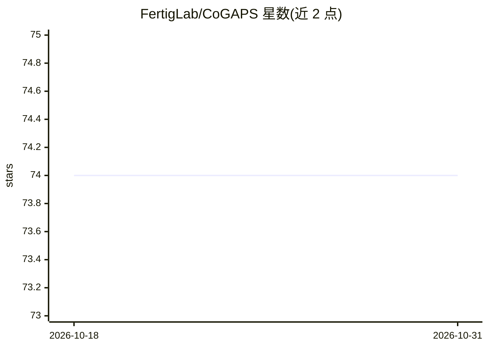

# FertigLab/CoGAPS

⭐ 74 · C++ · BSD-3-Clause · 推送 2026-08-12 · [GitHub](https://github.com/FertigLab/CoGAPS) · [官网](https://www.bioconductor.org/packages/release/bioc/html/CoGAPS.html) · 组织维护

**贝叶斯 MCMC 矩阵分解算法包，用于基因集活性推断**

CoGAPS（Coordinated Gene Activity in Pattern Sets）实现贝叶斯 MCMC 矩阵分解算法 GAPS，并与基因集统计方法连接以推断生物过程活性。可对任意数据做稀疏矩阵因子分解；当数据为生物分子时，可进行基因集分析。以 R 包形式通过 Bioconductor 或 GitHub 安装，另提供 nextflow 流程，通过参数指定 pattern 数、迭代次数、内存与 CPU 上限等，流程内以 Docker 容器（ghcr.io/fertiglab/cogaps）运行 COGAPS 与 COGAPS_PREPROCESS 过程。

## 筛选速览

| 维度 | 判定 | 备注 |
|---|---|---|
| AI 角色 | `ai-native` | 本体是模型或模型工具 |
| 许可风险 | `permissive` | BSD-3-Clause |
| 部署形态 | `None` |  |
| 模型依赖 | — | README 未给出锁定关系 |
| 硬件要求 | — | 无带数字的原话,不猜 |
| 安装摩擦 | `low` | 无编译、无系统依赖或容器化 |
| 成熟度 | — | 结构信号不足 |

## 能力要点

- 实现贝叶斯 MCMC 矩阵分解算法 GAPS 并连接基因集统计
- 支持对任意数据做稀疏矩阵因子分解
- 提供 nextflow 流程，支持 .rds 与 .h5ad 输入
- 流程内以 Docker 容器运行，容器版本可固定

## 适用场景

- 对单细胞或组学数据做稀疏矩阵分解
- 推断基因集对应的生物过程活性
- 以流程化方式批量运行多组 pattern 数实验

## 场景标签

 · 领域:生物信息学/计算生物学

## 证据(README 行号)

> L8: Coordinated Gene Activity in Pattern Sets (CoGAPS) implements a Bayesian MCMC matrix factorization algorithm, GAPS, 
> L31: The example below will attempt running CoGAPS with number of patterns 3 and 4 on every `.rds` and `.h5ad` file in t

## 星数曲线

2026-10-18 74 → 2026-10-31 74（+0）

---
*卡片 v1 · prompt 1.4 · 生成 2026-10-24 · 置信度 high · 依据 README sha `b2c41c768bbb` · [字段定义](../../DATASET.md)*
