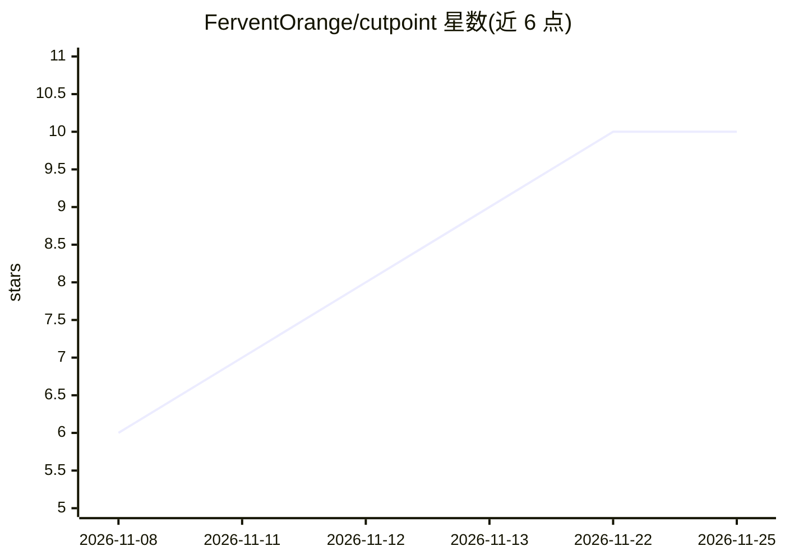

# FerventOrange/cutpoint

⭐ 10 · Python · MIT · 推送 2026-11-21 · [GitHub](https://github.com/FerventOrange/cutpoint) · [官网](https://pypi.org/project/cutpoint/) · 个人维护

**本地 AI 视频剪辑工具：自动找精彩片段并剪成成片**

Cutpoint 从长录像（游戏、运动相机、体育、谈话、360 视频）中检测精彩时刻，切出片段并组装成成片（含 9:16 竖版），输出 final.mp4 或可导入 DaVinci Resolve 的时间线，另生成带时间戳的转录。可通过 CLI 编码代理（Claude Code/Codex/Grok CLI 等）、本地浏览器工作区或单条命令驱动；全部分析在本地运行，可选 Ollama 做画面评分与场景描述，默认不改动原始文件。安装脚本自动配置 uv、Python 3.12 与 ffmpeg。

## 筛选速览

| 维度 | 判定 | 备注 |
|---|---|---|
| AI 角色 | `ai-native` | 本体是模型或模型工具 |
| 许可风险 | `permissive` | MIT |
| 部署形态 | `library` | 以包/库形式分发 |
| 模型依赖 | local-ok | 支持本地模型 |
| 硬件要求 | `cpu-ok` | |
| 安装摩擦 | `medium` | 含编译或系统依赖之一 |
| 成熟度 | — | 结构信号不足 |

## 能力要点

- 从长录像自动检测并切出精彩时刻，组装为成片或 DaVinci Resolve 时间线
- 支持 360 视频与竖版 9:16 输出，可选 Insta360 SDK 高质量拼接
- 可由任意 CLI 编码代理驱动，也提供本地浏览器工作区（cutpoint ui）
- 全本地运行，宿主模型可选且默认关闭

## 适用场景

- 把游戏直播录像剪成 60 秒精彩集锦
- 从运动相机骑行视频中生成竖版混剪
- 在导入 DaVinci Resolve 前先粗剪并筛选片段

## 场景标签

`图像视频处理` `语音识别` · 领域:感知与多模态

## 证据(README 行号)

> L5: Cutpoint finds the best moments in long recordings (gameplay, action-cam, sport, talk or 360
> L7: from the browser workspace or from the command line. All analysis runs on your own computer, so
> L32: 2. Open your agent (Claude Code, Codex, Grok CLI or any CLI agent) in the Cutpoint folder, or

## 星数曲线

2026-11-08 6 → 2026-11-25 10（+4）

---
*卡片 v1 · prompt 1.4 · 生成 2026-11-20 · 置信度 high · 依据 README sha `cb051a8f6b5e` · [字段定义](../../DATASET.md)*
