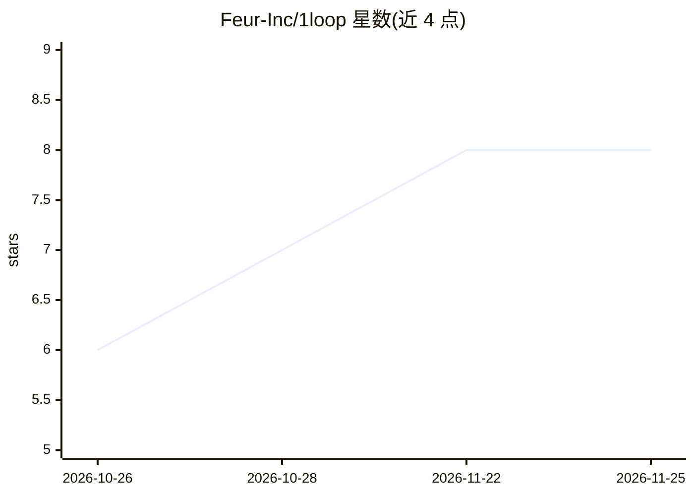

# Feur-Inc/1loop

⭐ 8 · Go · 推送 2026-11-23 · [GitHub](https://github.com/Feur-Inc/1loop) · [官网](https://feur-inc.github.io/1loop/) · 个人维护

**自托管的本地编码 agent，支持自选模型与多端运行**

运行在自己机器上的编码 agent：在项目文件夹内读取/编辑文件、运行 shell 命令、使用浏览器、维护任务列表，用户可逐条审批或交由 Auto 模式审查高危命令（Linux 上用 Landlock 沙箱）。同一 agent 提供 Linux/Windows 桌面版、headless server 与 Android 版，手机可经 QR 配对远程驱动桌面/服务器。模型接入支持 ChatGPT 账号登录、Claude Code、OpenRouter 及任意 OpenAI 兼容 API，可多账号并用；对话近上下文窗口时自动压缩，更新经签名清单校验。

## 筛选速览

| 维度 | 判定 | 备注 |
|---|---|---|
| AI 角色 | `ai-ecosystem` | LLM/agent 周边工具 |
| 许可风险 | `none` | — |
| 部署形态 | `desktop` | 安装包/桌面程序 |
| 模型依赖 | local-ok | 支持本地模型 |
| 硬件要求 | — | 无带数字的原话,不猜 |
| 安装摩擦 | `high` | 编译与系统依赖俱全 |
| 成熟度 | — | 结构信号不足 |

## 能力要点

- 多端运行：桌面（Linux/Windows）、headless server、Android，手机可远程驱动
- 接入 ChatGPT/Claude Code/OpenRouter/vLLM 及任意 OpenAI 兼容 API，多账号并存
- 三级审批模式：逐条审批、Auto 审查高危命令（Landlock 沙箱）、YOLO
- 对话跨设备迁移、草稿防丢失、签名自更新机制

## 适用场景

- 在本地项目文件夹中让 agent 读写代码并执行命令
- 用手机远程审批和操控桌面/服务器上的编码任务
- 用自有账号或自建 vLLM/OpenAI 兼容后端驱动 agent

## 场景标签

`编码 Agent` · 领域:编码与开发

## 证据(README 行号)

> L15: 1loop is a coding agent you run on your own machine, with the models you
> L22: - **Your models.** ChatGPT (sign in with your account), Claude Code, OpenRouter,
> L60: 2. **Connect a model.** Open **Settings → Connections**:

## 星数曲线

2026-10-26 6 → 2026-11-25 8（+2）

---
*卡片 v1 · prompt 1.4 · 生成 2026-11-20 · 置信度 mid · 依据 README sha `8ff2c193deee` · [字段定义](../../DATASET.md)*
