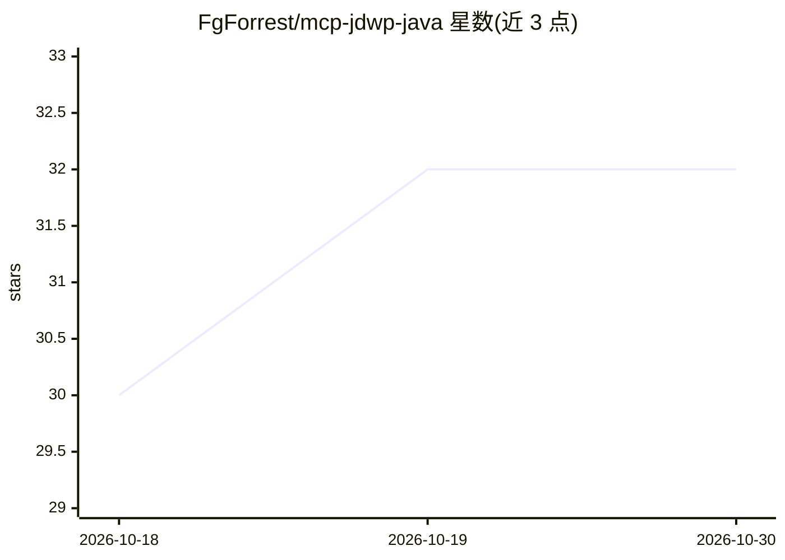

# FgForrest/mcp-jdwp-java

⭐ 32 · Java · MIT · 推送 2026-10-29 · [GitHub](https://github.com/FgForrest/mcp-jdwp-java) · 个人维护

**让 AI agent 通过 JDWP 远程调试运行中 Java 程序的 MCP 服务器**

基于 JDWP/JDI 协议的 MCP 服务器，把 Java 调试器能力以 47 个工具加 2 个资源的形式经 STDIO 暴露给 Claude Code 等 agent：读取局部变量/字段/线程与对象图、在挂起帧中编译执行 Java 表达式、运行时改写值、条件与异常断点、字段 watchpoint、logpoint 不停机记录等。服务器完全本地运行，无网络外呼，JAR 从源码本地构建；运行需 JDK 17+，构建需 JDK 21+。基于 Nicolas Vautrin 的原 mcp-jdwp-java 扩展，附带 9 个故意埋错的沙箱测试题。

## 筛选速览

| 维度 | 判定 | 备注 |
|---|---|---|
| AI 角色 | `ai-ecosystem` | LLM/agent 周边工具 |
| 许可风险 | `permissive` | MIT |
| 部署形态 | `desktop` | 安装包/桌面程序 |
| 模型依赖 | locked-api |  |
| 硬件要求 | — | 无带数字的原话,不猜 |
| 安装摩擦 | `medium` | 含编译或系统依赖之一 |
| 成熟度 | — | 结构信号不足 |

## 能力要点

- 47 个工具 + 2 个 MCP 资源：状态检查、表达式求值、运行时改值
- 条件/异常/延迟断点、字段 watchpoint、不停机 logpoint
- 纯 STDIO 本地运行，零外网请求，无遥测
- 插件市场一键安装并附 java-debug 技能与 9 个调试练习沙箱

## 适用场景

- 让 Claude Code 附加到 JVM 断点调试，定位失败测试的根因
- 不重启程序在挂起帧里改值做 what-if 实验
- 用字段 watchpoint 抓出后台线程覆盖配置的写入者

## 场景标签

 · 领域:开发工具/AI Agent 基础设施

## 证据(README 行号)

> L3: MCP server that gives AI agents full debugger control over running Java applications — inspect state, set breakpoint
> L11: An MCP server that speaks **JDWP** — the same protocol IntelliJ / Eclipse / VS Code use to attach — and exposes the

## 星数曲线

2026-10-18 30 → 2026-10-30 32（+2）

---
*卡片 v1 · prompt 1.4 · 生成 2026-10-26 · 置信度 high · 依据 README sha `770baa786f8a` · [字段定义](../../DATASET.md)*
