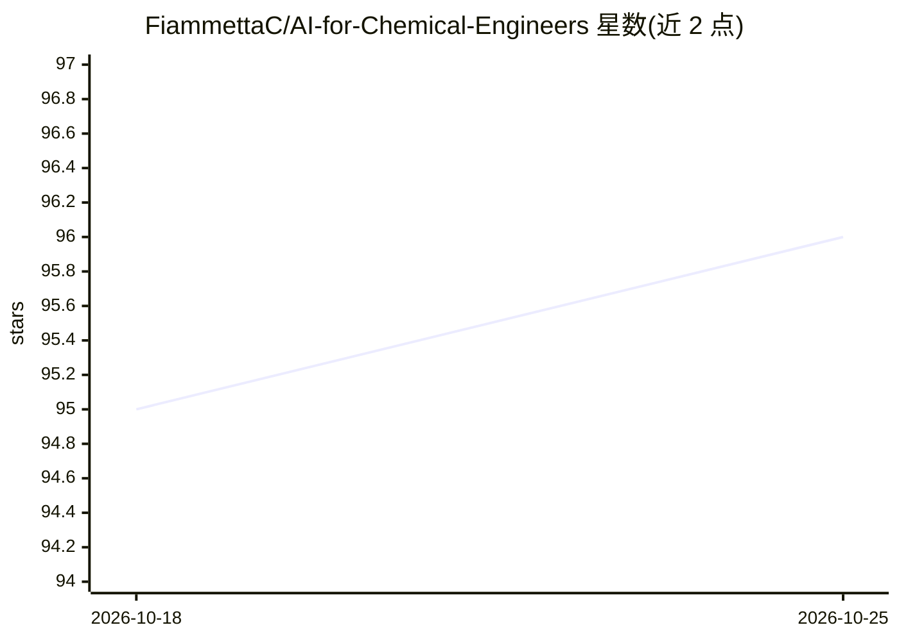

# FiammettaC/AI-for-Chemical-Engineers

⭐ 96 · Jupyter Notebook · NOASSERTION · 推送 2026-04-30 · [GitHub](https://github.com/FiammettaC/AI-for-Chemical-Engineers) · 组织维护

**面向化学工程师的 7 周 Python 与 AI 实践课程**

由 DTU 的 Fiammetta Caccavale 维护的自学课程，面向希望学习 AI 基础的化学工程师与学生。内容分 7 周：Python 语法与数据结构、机器学习（监督/无监督、分类回归、深度学习）、NLP（词句嵌入、mol2vec、语音转文字）、图像处理、图神经网络预测分子理化性质，以及 LIME/SHAP 可解释性。通过编码教程讲授 scikit-learn、PyTorch、TensorFlow 框架下的模型实现，配套讲义演示与视频教程，有配套论文可引用（SPyCE）。

## 筛选速览

| 维度 | 判定 | 备注 |
|---|---|---|
| AI 角色 | `ai-knowledge` | 知识聚合/清单类 |
| 许可风险 | `none` | NOASSERTION |
| 部署形态 | `None` |  |
| 模型依赖 | — | README 未给出锁定关系 |
| 硬件要求 | — | 无带数字的原话,不猜 |
| 安装摩擦 | `low` | 无编译、无系统依赖或容器化 |
| 成熟度 | — | 结构信号不足 |

## 能力要点

- 7 周自定进度课程，覆盖 Python、ML/DL、NLP、图像处理、GNN 与可解释性
- 用 GNN 结合化学信息学包预测有机分子理化性质
- 在 scikit-learn、PyTorch、TensorFlow 多框架下实现模型
- 配套讲义、视频教程及可引用论文（SPyCE, 2023）

## 适用场景

- 化学工程师从零入门 Python 与 AI
- 学习分子性质预测与图神经网络应用
- 按周自学并跟随编码练习实践 ML 模型

## 场景标签

`教程课程` · 领域:学习与行业

## 证据(README 行号)

> L4: This is a practical course designed for chemical engineers that want to learn the basics of AI. The course is very p
> L7: This course covers the following topics: (i) basics of the Python syntax, data pre-processing and analysis, (ii) fun

## 星数曲线

2026-10-18 95 → 2026-10-25 96（+1）

---
*卡片 v1 · prompt 1.4 · 生成 2026-10-23 · 置信度 high · 依据 README sha `271a761e0373` · [字段定义](../../DATASET.md)*
