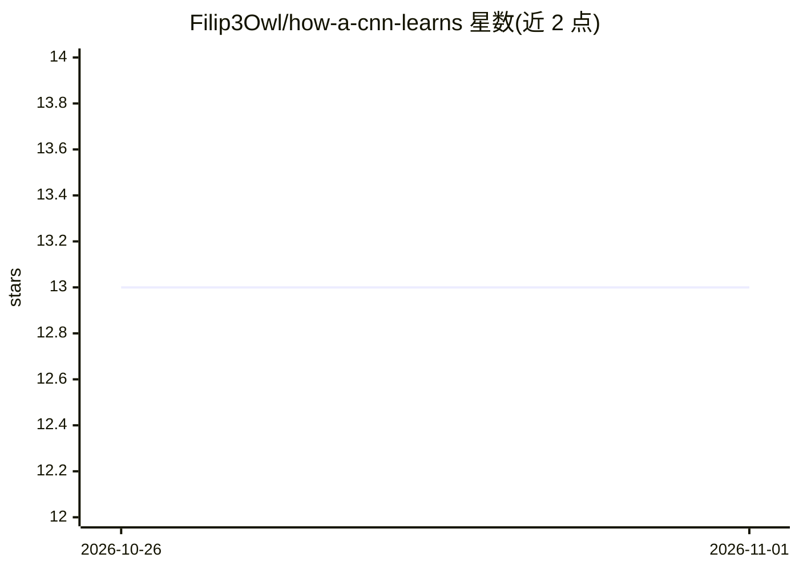

# Filip3Owl/how-a-cnn-learns

⭐ 13 · Jupyter Notebook · MIT · 推送 2026-10-24 · [GitHub](https://github.com/Filip3Owl/how-a-cnn-learns) · 个人维护

**用真实网络数值生成动画讲解 CNN 学习原理的教程笔记本系列**

面向深度学习学习者的 Jupyter notebook 系列：将卷积、池化、损失面、梯度下降等机制渲染为动画，所有数值来自真实网络的前向/反向计算而非示意图。提供 NumPy 从零实现（早期章节）与 PyTorch 后端（深层网络），从零实现的梯度经 PyTorch autograd 与有限差分校验。附带的 cnnviz 库处理 GIF/MP4 动画工艺（共享调色板、增量编码、变帧时长）与多语言/暗色主题，并带社交媒体画布预设。系列共 8 章，当前完成 3 章，其余为 planned。需 Python 3.10/3.11，torch 固定 2.2.2、numpy<2（因 macOS Intel 兼容）。

## 筛选速览

| 维度 | 判定 | 备注 |
|---|---|---|
| AI 角色 | `ai-knowledge` | 知识聚合/清单类 |
| 许可风险 | `permissive` | MIT |
| 部署形态 | `library` | 以包/库形式分发 |
| 模型依赖 | — | README 未给出锁定关系 |
| 硬件要求 | — | 无带数字的原话,不猜 |
| 安装摩擦 | `low` | 无编译、无系统依赖或容器化 |
| 成熟度 | `idea` | |

## 能力要点

- 动画由真实网络数值计算生成，非手绘示意
- NumPy 从零实现 + PyTorch 双后端，梯度经 autograd 与有限差分校验
- cnnviz 动画库：共享调色板、增量编码（约 1.8MB→0.5MB）、变帧时长
- 输出支持 GIF 与可发布的 H.264 MP4（yuv420p、静音 AAC、faststart）

## 适用场景

- 通过动画逐帧理解卷积、ReLU、池化与梯度下降的实际数值过程
- 教学或科普时直接使用 results/ 下可排序的 GIF 产物
- 将动画按手机画布预设裁切后发布到社交平台

## 场景标签

`教程课程` · 领域:学习与行业

## 证据(README 行号)

> L3: A notebook series that explains deep learning **visually**. Every mechanism (convolution,
> L22: - **NumPy, from scratch** (`src/cnnviz/layers.py`) for the early notebooks.
> L26: - **PyTorch** for the deeper networks, where from-scratch training becomes too

## 星数曲线

2026-10-26 13 → 2026-11-01 13（+0）

---
*卡片 v1 · prompt 1.4 · 生成 2026-10-31 · 置信度 mid · 依据 README sha `c786dc343fd2` · [字段定义](../../DATASET.md)*
