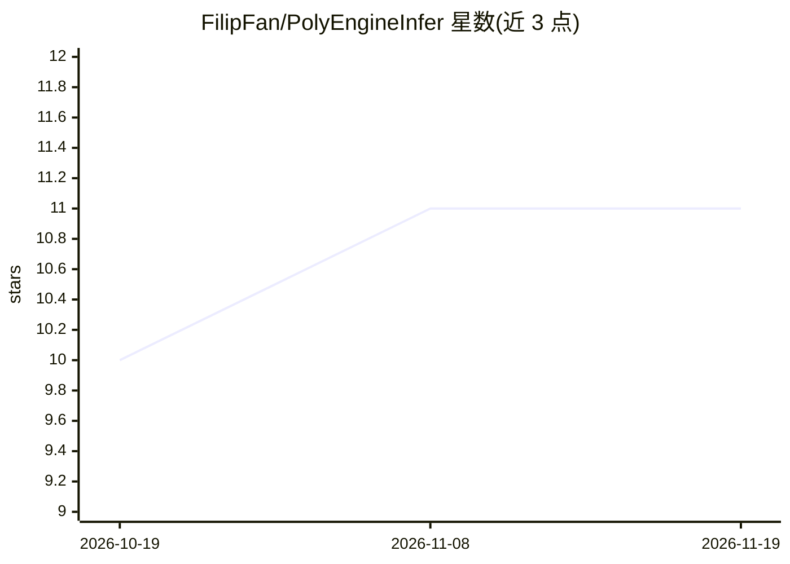

# FilipFan/PolyEngineInfer

⭐ 11 · Kotlin · Apache-2.0 · 推送 2026-03-29 · [GitHub](https://github.com/FilipFan/PolyEngineInfer) · 个人维护

**在单一 Android 应用内运行多引擎端侧 LLM 推理**

实验性 Android 应用，集成 llama.cpp、ONNX Runtime (GenAI)、ExecuTorch、LiteRT-LM 等多个端侧推理引擎，可按模型文件扩展名自动选择引擎并加载聊天。支持调整 top-k、top-p、temperature 等推理参数，展示首 token 时间、prefill/decode 速度等性能指标。模型需通过 adb push 推送到应用外部存储目录后使用。限制包括多轮对话不保留上下文、仅支持文本输入，支持 arm64-v8a 与 x86_64 架构。

## 筛选速览

| 维度 | 判定 | 备注 |
|---|---|---|
| AI 角色 | `ai-native` | 本体是模型或模型工具 |
| 许可风险 | `permissive` | Apache-2.0 |
| 部署形态 | `None` |  |
| 模型依赖 | local-ok | 支持本地模型 |
| 硬件要求 | — | 无带数字的原话,不猜 |
| 安装摩擦 | `low` | 无编译、无系统依赖或容器化 |
| 成熟度 | `idea` | |

## 能力要点

- 单应用内多引擎推理：llama.cpp / ONNX / ExecuTorch / LiteRT-LM
- 按模型文件扩展名自动选择推理引擎
- top-k/top-p/temperature 参数可调，展示首 token 时间与 prefill/decode 速度
- 支持 Vulkan（ExecuTorch）与 OpenCL（LiteRT）GPU 后端切换

## 适用场景

- 在同一台 Android 设备上对比不同推理引擎的表现
- 测量端侧 LLM 的首 token 延迟与解码速度
- 在无网络环境下运行本地开源 LLM 聊天

## 场景标签

`推理引擎` · 领域:训练与推理

## 证据(README 行号)

> L3: An experimental Android application that integrates multiple on-device inference engines, allowing you to run infere
> L7: - **Multi-Engine Support:** Load and chat with models supported by different inference engines.

## 星数曲线

2026-10-19 10 → 2026-11-19 11（+1）

---
*卡片 v1 · prompt 1.4 · 生成 2026-11-19 · 置信度 high · 依据 README sha `5c7843717efa` · [字段定义](../../DATASET.md)*
