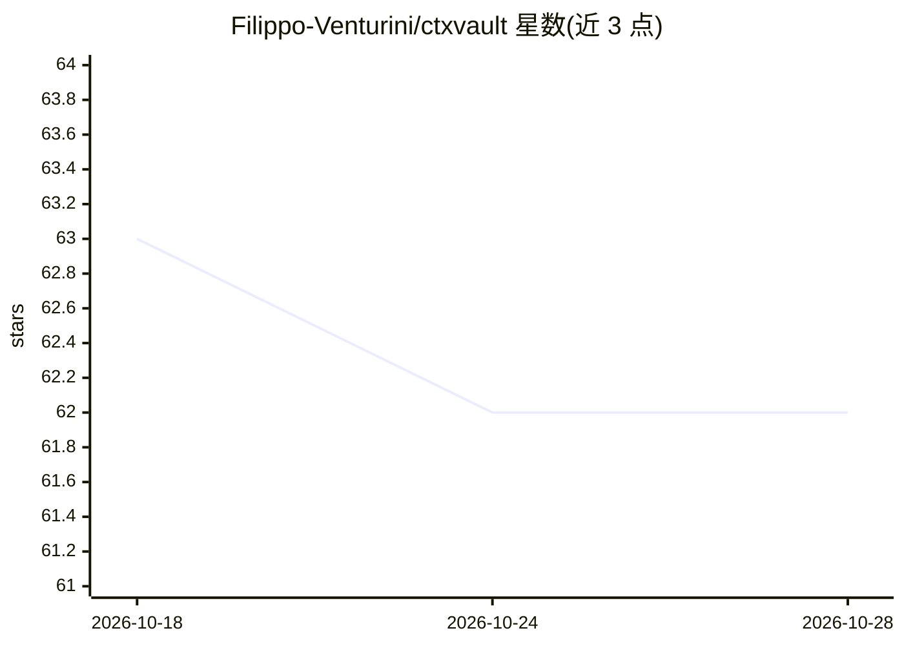

# Filippo-Venturini/ctxvault

⭐ 62 · Python · MIT · 推送 2026-10-26 · [GitHub](https://github.com/Filippo-Venturini/ctxvault) · [官网](https://filippo-venturini.github.io/ctxvault/) · 个人维护

**面向 AI agent 的本地记忆基础设施：隔离的分区化知识库**

为 AI agent 提供持久化记忆层的 Python 工具：记忆组织为目录背书的 vault 单元，分为语义型（文档+向量检索）、技能型（自然语言程序）和情景型（带双时态有效期的陈述，支持 supersede 与时间回溯）三类。隔离与访问控制为结构化设计，各 vault 独立索引，可声明 restricted。通过 CLI、REST API（FastAPI）与 MCP server 三种接口暴露同一层，供 Claude Desktop 等客户端直连。本地优先，无云端与遥测；Python 3.10+，PyPI 安装。

## 筛选速览

| 维度 | 判定 | 备注 |
|---|---|---|
| AI 角色 | `ai-ecosystem` | LLM/agent 周边工具 |
| 许可风险 | `permissive` | MIT |
| 部署形态 | `library` | 以包/库形式分发 |
| 模型依赖 | — | README 未给出锁定关系 |
| 硬件要求 | — | 无带数字的原话,不猜 |
| 安装摩擦 | `low` | 无编译、无系统依赖或容器化 |
| 成熟度 | — | 结构信号不足 |

## 能力要点

- 三类 vault：语义/技能/情景（双时态、supersede、时间回溯）
- CLI + REST API + MCP server 三种接口暴露同一 vault 层
- 结构化隔离与基于 agent 的访问控制（restricted vault）
- 完全本地，vault 为机器上的普通目录，可人工读取编辑

## 适用场景

- 让 agent 在会话之间保持持久记忆
- 多 agent 场景下按拓扑隔离知识与技能并控制访问
- 通过 Claude Desktop 等 MCP 客户端直连本地知识库
- 人类通过 CLI 监督 agent 写入的记忆并直接投喂文档

## 场景标签

`Agent 记忆` · 领域:Agent 开发

## 证据(README 行号)

> L17: CtxVault is built around a different primitive. Memory is organized into **vaults**: self-contained, directory-back
> L96: **HTTP API**: Programmatic integration. Connect LangChain, LangGraph, or any custom pipeline to vaults via REST. Fu
> L98: **MCP server**: For autonomous agents. Give any MCP-compatible client direct vault access with no integration code 

## 星数曲线

2026-10-18 63 → 2026-10-28 62（-1）

---
*卡片 v1 · prompt 1.4 · 生成 2026-10-24 · 置信度 high · 依据 README sha `355064456ab7` · [字段定义](../../DATASET.md)*
