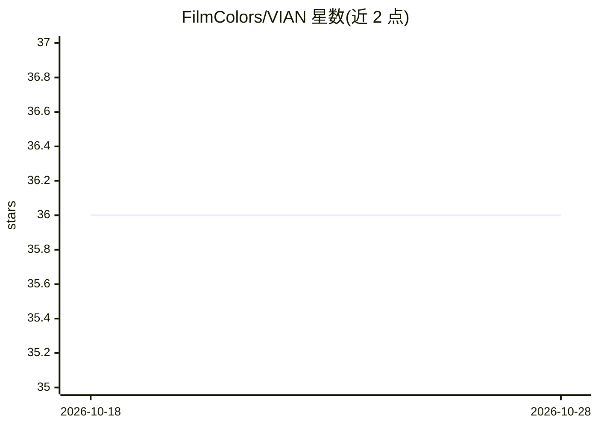

# FilmColors/VIAN

⭐ 36 · Python · GPL-3.0 · 推送 2026-01-06 · [GitHub](https://github.com/FilmColors/VIAN) · 组织维护

**用于电影色彩标注、分析与可视化的软件包**

VIAN 是一个用于电影中色彩标注、分析与可视化的软件包（Beta 版），面向电影学者与色彩研究人员。基于 Python 3 开发，推荐通过 Anaconda 安装：提供 requirements.yml、environment_macos.yml 与 environment.yml 环境文件，用 conda 创建环境后运行 python build.py 与 main.py 启动，支持 macOS 与 Windows。使用其他 Python 3 发行版安装未测试。

## 筛选速览

| 维度 | 判定 | 备注 |
|---|---|---|
| AI 角色 | `ai-enhanced` | 去掉 AI 部分产品仍成立 |
| 许可风险 | `viral` | GPL-3.0 |
| 部署形态 | `None` |  |
| 模型依赖 | — | README 未给出锁定关系 |
| 硬件要求 | — | 无带数字的原话,不猜 |
| 安装摩擦 | `low` | 无编译、无系统依赖或容器化 |
| 成熟度 | `idea` | |

## 能力要点

- 电影色彩的标注、分析与可视化
- 提供 macOS 与 Windows 两套 conda 环境配置
- 通过 conda 环境加 main.py 脚本方式运行

## 适用场景

- 对影片镜头进行色彩标注与可视化
- 开展电影色彩风格的学术分析
- 整理影片色彩数据用于研究展示

## 场景标签

`图像视频处理` `科研工具` · 领域:学习与行业

## 证据(README 行号)

> L5: Welcome to the repo of VIAN, software package for annotating, analysing and
> L6: visualizing color in film.

## 星数曲线

2026-10-18 36 → 2026-10-28 36（+0）

---
*卡片 v1 · prompt 1.4 · 生成 2026-10-25 · 置信度 mid · 依据 README sha `da60a2ab0e86` · [字段定义](../../DATASET.md)*
